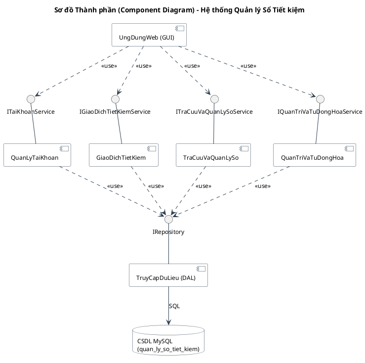
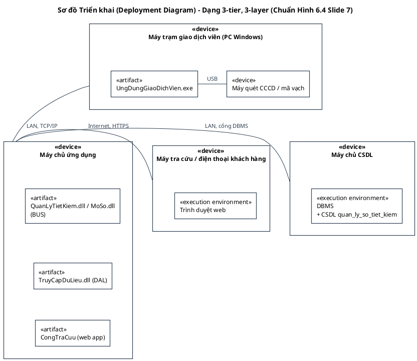

# 02 — Sơ đồ Thành phần & Sơ đồ Triển khai (Component & Deployment Diagram)

> **Môn học:** Phân tích và Thiết kế Hướng đối tượng (841111 - Chương 6: Mục 6.2.2 & Mục 6.4)  
> **Căn cứ lý thuyết:** Slide bài giảng Chương 6 (Hình 6.3 - Trang 5 và Hình 6.4 - Trang 7)  
> **Căn cứ thực tế dự án:** 4 nhóm Use Case trong `Use case.docx`, Báo cáo lớp phân tích `Bao_cao_so_do_lop_phan_tich.docx`, và CSDL `schema.sql`.

---

# PHẦN 1: SƠ ĐỒ THÀNH PHẦN (COMPONENT DIAGRAM - Mục 6.2.2)

## 1.1. Khái niệm & Nguyên tắc Thiết kế

Theo định nghĩa bài giảng (Slide trang 3 & 4):

- **Thành phần (Component):** Là một khối phần mềm có thể thay thế của hệ thống, đóng gói phần hiện thực bên trong, chỉ giao tiếp với bên ngoài qua giao diện.
- **Giao diện cung cấp (Provided Interface - Kẹo mút):** Dịch vụ mà thành phần cung cấp cho bên ngoài.
- **Giao diện yêu cầu (Required Interface - Ổ cắm hoặc mũi tên nét đứt «use» tới giao diện):** Dịch vụ thành phần cần từ bên ngoài.
- **Quy tắc gom nhóm:** Theo **Hình 6.3 - Trang 5 slide bài giảng**, các nhóm lớp của tầng BLL (Business Logic Layer) được gom theo **nhóm Use Case**. Tầng DAL được đóng gói thành một thành phần thống nhất `TruyCapDuLieu (DAL)` cung cấp `IRepository`.

## 1.2. Danh mục các Thành phần (Components)

| Tầng    | Tên Thành phần (Component) | Nhóm lớp tương ứng từ Sơ đồ phân tích                                                                                          | Vai trò & Trách nhiệm                                                                                                                                                                           |
| :------ | :------------------------- | :----------------------------------------------------------------------------------------------------------------------------- | :---------------------------------------------------------------------------------------------------------------------------------------------------------------------------------------------- |
| **GUI** | `UngDungWeb (GUI)`         | `GiaoDienDangNhap`, `GiaoDienMoSoOnline`, `GiaoDienMoSoTaiQuay`, `GiaoDienTatToan`, `GiaoDienQuanLySo`, `GiaoDienBaoCao`...    | Hiển thị giao diện người dùng, tiếp nhận thao tác, kiểm tra định dạng và gọi các giao diện dịch vụ của BLL.                                                                                     |
| **BLL** | `QuanLyTaiKhoan`           | `DieuKhienXacThuc`, `DieuKhienHoSoCaNhan`, `DieuKhienTKVaPhanQuyen`                                                            | Xử lý đăng nhập, quản lý phiên làm việc, khóa tài khoản sai 5 lần (FR-01, EX-01), cập nhật hồ sơ cá nhân (FR-02), quản trị tài khoản và phân quyền (FR-11).                                     |
| **BLL** | `GiaoDichTietKiem`         | `DieuKhienMoSo`, `DieuKhienTatToan`, `DieuKhienTinhLai`                                                                        | Xử lý mở sổ online (FR-03), mở sổ tại quầy (FR-04), tất toán đúng hạn/trước hạn (FR-07, EX-03), tính lãi phát sinh (FR-06), điều phối trừ tiền và hạch toán giao dịch.                          |
| **BLL** | `TraCuuVaQuanLySo`         | `DieuKhienKhachHang`, `DieuKhienQuanLySo`                                                                                      | Xử lý tra cứu đa tiêu chí thông tin sổ tiết kiệm (FR-05), chuyển đổi trạng thái sổ (phong tỏa, giải tỏa, báo mất) (FR-09), quản lý hồ sơ định danh khách hàng (FR-08).                          |
| **BLL** | `QuanTriVaTuDongHoa`       | `DieuKhienDanhMucVaLS`, `DieuKhienBaoCao`, `DieuKhienTaiTuc`, `DieuKhienThongBao`                                              | Xử lý cấu hình kỳ hạn và biểu lãi suất (FR-12), tổng hợp số liệu báo cáo doanh số/mở đóng sổ (FR-10), tiến trình tự động gửi thông báo đáo hạn (FR-13) và tự động tái tục sổ cuối ngày (FR-14). |
| **DAL** | `TruyCapDuLieu (DAL)`      | Toàn bộ các DAO tương ứng với 19 bảng CSDL: `SoTietKiemDAO`, `TaiKhoanDAO`, `GiaoDichDAO`, `KhachHangDAO`, `BieuLaiSuatDAO`... | Thực thi các câu lệnh SQL truy vấn và cập nhật dữ liệu; quản lý kết nối CSDL và phân định ranh giới Transaction ACID (`BEGIN`, `COMMIT`, `ROLLBACK`).                                           |

## 1.3. Danh mục Giao diện (Provided & Required Interfaces)

| Tên Giao diện (Interface)     | Do Thành phần nào Cung cấp (Provided) | Thành phần nào Cần (Required)               | Các phương thức chính (Operations)                                                                                                                                    |
| :---------------------------- | :------------------------------------ | :------------------------------------------ | :-------------------------------------------------------------------------------------------------------------------------------------------------------------------- |
| `ITaiKhoanService`            | `QuanLyTaiKhoan`                      | `UngDungWeb (GUI)`                          | `xacThucDangNhap(tenDangNhap, matKhau)` `xemVaCapNhatHoSo(maNguoiDung, thongTin)` `taoTaiKhoanVaGanVaiTro(thongTin)`                                            |
| `IGiaoDichTietKiemService`    | `GiaoDichTietKiem`                    | `UngDungWeb (GUI)`                          | `moSoOnline(thongTin)` `moSoTaiQuay(thongTin)` `tinhLaiDuKien(soTien, kyHan, laiSuat)` `yeuCauTatToan(maSo, loaiTatToan)`                                    |
| `ITraCuuVaQuanLySoService`    | `TraCuuVaQuanLySo`                    | `UngDungWeb (GUI)`                          | `traCuuSoTietKiem(tieuChi)` `capNhatTrangThaiSo(maSo, trangThaiMoi, lyDo)` `quanLyThongTinKhachHang(thongTin)`                                                  |
| `IQuanTriVaTuDongHoaService`  | `QuanTriVaTuDongHoa`                  | `UngDungWeb (GUI)`, `Bộ Scheduler Hệ thống` | `capNhatBieuLaiSuat(maKyHan, laiSuatMoi)` `xuatBaoCaoThongKe(tieuChi)` `xuLyQuetThongBaoDaoHan()` `xuLyTaiTucTuDong()`                                       |
| `IRepository` _(Data Access)_ | `TruyCapDuLieu (DAL)`                 | Cả 4 Thành phần BLL                         | `findCustomerById()`, `getAccountBalance()`, `updateAccountBalance()` `createPassbook()`, `createTransaction()`, `saveStatusLog()` `runInTransaction(callback)` |
| `SQL / TCP 3306`              | _Hệ quản trị MySQL_                   | `TruyCapDuLieu (DAL)`                       | Chuẩn giao thức mạng MySQL Driver                                                                                                                                     |

> [!NOTE]
> **Tính chất Decoupling (Slide trang 5):**  
> Nhờ phân tách tầng độc lập, chúng ta có thể thay thế toàn bộ thành phần `TruyCapDuLieu (DAL)` (ví dụ: đổi hệ quản trị CSDL) mà **hoàn toàn không phải sửa đổi** bất kỳ dòng code nào trong 4 thành phần BLL, miễn là giao diện `IRepository` được giữ nguyên.

## 1.4. Mã PlantUML Sơ đồ Thành phần (Component Diagram)

Đoạn mã PlantUML dưới đây được thiết kế chuẩn xác theo **Hình 6.3 - Slide 5**:

- Không dùng khối bao cứng gây lỗi gập dây và chữ bị gạch ngang.
- Khai báo chuẩn `interface` giúp tên giao diện hiển thị rõ ràng, tách bạch.
- Các đường phụ thuộc `<<use>>` từ GUI xuống BLL và từ BLL xuống `IRepository` của DAL đi theo các đường thẳng/chéo tự nhiên, không bị quấn dây vòng qua mép ngoài:

---

# PHẦN 2: SƠ ĐỒ TRIỂN KHAI (DEPLOYMENT DIAGRAM - Mục 6.4)

## 2.1. Khái niệm & Nguyên tắc Thiết kế

Theo định nghĩa bài giảng (Slide trang 6 & 7):

- **Sơ đồ triển khai:** Mô tả cấu hình phần cứng lúc chạy (Run-time Hardware Configuration) – cách thể hiện bằng UML của khái niệm **Tier** (Kiến trúc 3-tier, 3-layer).
- **Trình bày chuẩn theo Hình 6.4 - Slide trang 7:** Thiết kế mô hình kiến trúc chuẩn của hệ thống tài chính / ngân hàng, không phụ thuộc vào tên file tạm thời trong thư mục sườn (skeleton) lúc đang code.
- **Các thành phần chính trên sơ đồ:**
  - Node khách hàng (Client tier): Máy trạm giao dịch viên và thiết bị khách hàng.
  - Node máy chủ ứng dụng (Application Server tier): Chứa các thành phần thực thi nghiệp vụ (BUS/BLL) và truy cập dữ liệu (DAL).
  - Node máy chủ cơ sở dữ liệu (Database Server tier): Chứa DBMS và CSDL.

## 2.2. Danh mục các Node & Artifacts Kiến trúc Chuẩn (Khớp 100% Slide 7)

| Node Triển khai | Kiểu Node (Stereotype) | Môi trường Thực thi / Thành phần bên trong | Artifacts Triển khai Chuẩn |
| :--- | :--- | :--- | :--- |
| **Máy trạm giao dịch viên** | `«device»` PC Windows tại quầy | • `«artifact» UngDungGiaoDichVien.exe` • `«device» Máy quét CCCD / mã vạch` (nối qua cổng `USB`) | Ứng dụng Desktop chuyên dụng cho giao dịch viên nội bộ tại chi nhánh ngân hàng. |
| **Máy tra cứu / Điện thoại KH** | `«device»` Máy tính cá nhân / Smartphone | `«execution environment» Trình duyệt web` | Khách hàng dùng trình duyệt truy cập ứng dụng web từ xa. |
| **Máy chủ ứng dụng** | `«device»` Application Server | Chứa toàn bộ các thành phần BLL, DAL và web app: | • `«artifact» QuanLyTietKiem.dll / MoSo.dll (BUS)` • `«artifact» TruyCapDuLieu.dll (DAL)` • `«artifact» CongTraCuu (web app)` |
| **Máy chủ CSDL** | `«device»` Database Server | `«execution environment» DBMS` | `+ CSDL quan_ly_so_tiet_kiem` |

## 2.3. Đường truyền & Giao thức Kết nối (Chuẩn Đường nối UML không mũi tên)

| Kết nối (Connection Path) | Giao thức Mạng / Cổng | Chức năng Truyền thông |
| :--- | :--- | :--- |
| **Máy trạm giao dịch viên $\longleftrightarrow$ Máy quét CCCD / mã vạch** | `USB` | Kết nối thiết bị ngoại vi quét CCCD định danh khách hàng tại quầy. |
| **Máy trạm giao dịch viên $\longleftrightarrow$ Máy chủ ứng dụng** | `LAN, TCP/IP` | Giao dịch viên thực hiện mở sổ, lập phiếu tại quầy nội bộ. |
| **Máy tra cứu / Khách hàng $\longleftrightarrow$ Máy chủ ứng dụng** | `Internet, HTTPS` | Khách hàng truy cập ứng dụng web tra cứu và mở sổ online. |
| **Máy chủ ứng dụng $\longleftrightarrow$ Máy chủ CSDL** | `LAN, cổng DBMS` | Máy chủ ứng dụng truy vấn và cập nhật dữ liệu vào CSDL. |

## 2.4. Mã PlantUML Sơ đồ Triển khai (Deployment Diagram - Chuẩn Hình 6.4 Slide 7)

> [!NOTE]
> **Điểm cải tiến về bố cục và hình thức (Tránh dạng khối hộp 3D khó nhìn):**
> - Sử dụng toàn bộ khối phẳng 2D chữ nhật (`rectangle`) với góc vuông (`roundCorner 0`) và không đổ bóng (`shadowing false`), loại bỏ triệt để các khối hộp 3D méo mó của từ khóa `node` mặc định.
> - Bố cục phân bổ chuẩn 3 cột: Cột trái (Client tier), Cột giữa (App Server tier dạng cột đứng chứa 3 artifacts xếp dọc), Cột phải (Database tier).
> - Đường truyền thông (Communication Path) là đường nét liền chuẩn UML **không có mũi tên** (`--`), kèm nhãn giao thức mạng y hệt Slide 7.

