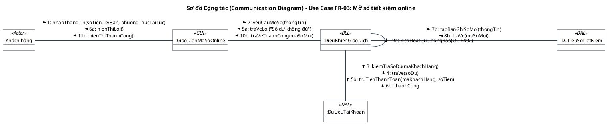
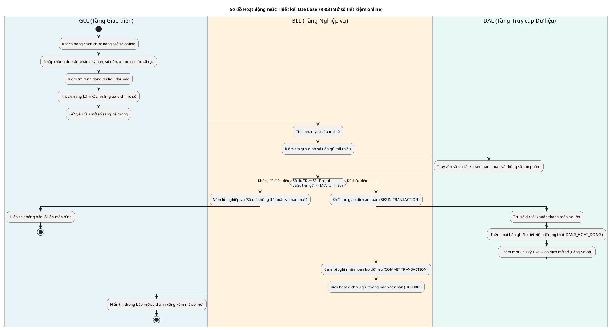

# 03 — Sơ đồ Cộng tác & Sơ đồ Hoạt động mức Thiết kế (Collaboration & Activity Diagram)

> **Môn học:** Phân tích và Thiết kế Hướng đối tượng (841111 - Chương 6: Mục 6.2.3 & Mục 6.2.4)  
> **Căn cứ lý thuyết:** Slide bài giảng Chương 6 (Hình 6.5 - Trang 10 và Hình 6.6 - Trang 12)  
> **Căn cứ thực tế dự án:**  
> - Use Case trọng tâm: **FR-03 (Mở sổ tiết kiệm online)** trong `Use case.docx`.  
> - Sơ đồ tuần tự gốc: `docs/Sequence/FR 03.png` (Chương 5).  
> - Sơ đồ hoạt động gốc: `docs/Activity/FR 03.png` (Chương 4).  
> - Sơ đồ lớp phân tích: `docs/Class/Bao_cao_so_do_lop_phan_tich.docx`.  
> - CSDL chuẩn đã hiệu chỉnh: `backend/database/schema.sql` (bảng `TAI_KHOAN_THANH_TOAN` đã có `so_du`, `SO_TIET_KIEM.nhan_vien_mo_id` cho phép `NULL`).

---

# PHẦN 1: SƠ ĐỒ CỘNG TÁC (COLLABORATION / COMMUNICATION DIAGRAM - Mục 6.2.3)

## 1.1. Khái niệm & Nguyên tắc Chuyển đổi từ Sequence Diagram
Theo bài giảng Chương 6 (Slide trang 9 & 10):
* **Sơ đồ cộng tác (UML 2 gọi là Communication Diagram):** Chứa cùng thông tin với Sequence Diagram, nhưng **nhấn mạnh vào liên kết giữa các đối tượng** thay vì trục thời gian thẳng đứng.
* **Quy tắc đánh số thứ tự:** Khớp 100% với các thông điệp trong `docs/Sequence/FR 03.png`, bao gồm các nhánh rẽ điều kiện `alt [soDu < soTien]` (nhánh 5a, 6a) và `[soDu >= soTien]` (nhánh 5b đến 11b).
* **Mở rộng sang mức thiết kế 3 tầng (Slide trang 10):**  
  Ở Chương 5, sơ đồ tuần tự phân tích chỉ dùng các đối tượng trừu tượng. Ở mức thiết kế, ta ánh xạ định danh 3 tầng chuẩn xác:
  * **Tầng GUI:** `:GiaoDienMoSoOnline` (Boundary)
  * **Tầng BLL:** `:DieuKhienGiaoDich` (Control)
  * **Tầng DAL:** `:DuLieuTaiKhoan` (Entity / `TaiKhoanDAO`) và `:DuLieuSoTietKiem` (Entity / `SoTietKiemDAO`)
  * **Mỗi thông điệp tới một đối tượng sẽ trở thành một phương thức (Method) chính thức của lớp đó trong sơ đồ lớp mức thiết kế.**

## 1.2. Danh sách Đối tượng Tham gia

| Tầng | Tên Đối tượng trong Sơ đồ | Lớp (Class) tương ứng | Vai trò trong Use Case FR-03 |
| :--- | :--- | :--- | :--- |
| **Actor** | `Khách hàng` | Người dùng đóng vai trò Khách hàng | Tác nhân thực hiện thao tác mở sổ online trên ứng dụng/web. |
| **GUI** | `:GiaoDienMoSoOnline` | `GiaoDienMoSoOnline` (Boundary) | Thu thập thông tin form mở sổ, kiểm tra định dạng và hiển thị kết quả/lỗi. |
| **BLL** | `:DieuKhienGiaoDich` | `DieuKhienGiaoDich` (Control) | Điều phối nghiệp vụ: kiểm tra quy định, yêu cầu kiểm tra số dư, quản lý transaction trừ tiền và tạo sổ. |
| **DAL** | `:DuLieuTaiKhoan` | `TaiKhoanDAO` / `DuLieuTaiKhoan` | Thực thi kiểm tra số dư và trừ số dư tài khoản thanh toán nguồn (`TAI_KHOAN_THANH_TOAN`). |
| **DAL** | `:DuLieuSoTietKiem`| `SoTietKiemDAO` / `DuLieuSoTietKiem`| Thực thi ghi sổ mới, chu kỳ và giao dịch (`SO_TIET_KIEM`, `CHU_KY_SO_TIET_KIEM`, `GIAO_DICH_TIET_KIEM`). |

## 1.3. Bảng Truy vết Luồng Thông điệp (Khớp 100% Sequence/FR 03.png)

| Thứ tự thông điệp | Đối tượng gửi $\rightarrow$ Đối tượng nhận | Tên thông điệp / Phương thức (Operations) | Ý nghĩa nghiệp vụ |
| :---: | :--- | :--- | :--- |
| **1** | `Khách hàng` $\rightarrow$ `:GiaoDienMoSoOnline` | `nhapThongTin(soTien, kyHan, phuongThucTaiTuc)` | Khách hàng điền biểu mẫu mở sổ và chọn xác nhận trên giao diện. |
| **2** | `:GiaoDienMoSoOnline` $\rightarrow$ `:DieuKhienGiaoDich` | `yeuCauMoSo(thongTin)` | Giao diện gửi yêu cầu mở sổ sang tầng BLL xử lý. |
| **3** | `:DieuKhienGiaoDich` $\rightarrow$ `:DuLieuTaiKhoan` | `kiemTraSoDu(maKhachHang)` | BLL yêu cầu DAL đọc số dư tài khoản thanh toán của khách. |
| **4** | `:DuLieuTaiKhoan` $\rightarrow$ `:DieuKhienGiaoDich` | `traVe(soDu)` | DAL trả về số dư thực tế từ cơ sở dữ liệu. |
| *Nhánh lỗi* | *Điều kiện: [soDu < soTien]* | | |
| **5a** | `:DieuKhienGiaoDich` $\rightarrow$ `:GiaoDienMoSoOnline`| `traVeLoi("Số dư không đủ")` | BLL từ chối mở sổ và trả thông báo lỗi về GUI. |
| **6a** | `:GiaoDienMoSoOnline` $\rightarrow$ `Khách hàng` | `hienThiLoi()` | GUI hiển thị lỗi trực tiếp lên màn hình và kết thúc. |
| *Nhánh thành công* | *Điều kiện: [soDu >= soTien]* | | *(Ghi CSDL trong một Transaction ACID)* |
| **5b** | `:DieuKhienGiaoDich` $\rightarrow$ `:DuLieuTaiKhoan` | `truTienThanhToan(maKhachHang, soTien)` | BLL yêu cầu DAL cập nhật trừ số dư tiền gửi. |
| **6b** | `:DuLieuTaiKhoan` $\rightarrow$ `:DieuKhienGiaoDich` | `thanhCong` | DAL xác nhận đã trừ tiền tài khoản thành công. |
| **7b** | `:DieuKhienGiaoDich` $\rightarrow$ `:DuLieuSoTietKiem`| `taoBanGhiSoMoi(thongTin)` | BLL yêu cầu DAL ghi sổ mới, chu kỳ và giao dịch. |
| **8b** | `:DuLieuSoTietKiem` $\rightarrow$ `:DieuKhienGiaoDich`| `traVe(maSoMoi)` | DAL trả về mã định danh sổ mới vừa tạo. |
| **9b** | `:DieuKhienGiaoDich` $\rightarrow$ `:DieuKhienGiaoDich`| `kichHoatGuiThongBao(UC-EX02)` | BLL kích hoạt gửi Email/SMS xác nhận mở sổ. |
| **10b** | `:DieuKhienGiaoDich` $\rightarrow$ `:GiaoDienMoSoOnline`| `traVeThanhCong(maSoMoi)` | BLL thông báo hoàn tất giao dịch mở sổ về GUI. |
| **11b** | `:GiaoDienMoSoOnline` $\rightarrow$ `Khách hàng` | `hienThiThanhCong()` | GUI hiển thị giao diện chúc mừng và thông tin mã sổ mới. |

## 1.4. Mã PlantUML Sơ đồ Cộng tác (Communication Diagram)

Đoạn mã PlantUML dưới đây khớp 100% với các thông điệp từ `docs/Sequence/FR 03.png`:
- Đường tự gọi `9b` được định hướng `-up-` uốn lên phía trên trống trải, hoàn toàn không đè lên đường nối sang `DAL_SO`.
- Đảm bảo trật tự không gian chuẩn: `KH` $\rightarrow$ `GUI` $\rightarrow$ `BLL` $\rightarrow$ `DAL`.

---

# PHẦN 2: SƠ ĐỒ HOẠT ĐỘNG MỨC THIẾT KẾ (DESIGN-LEVEL ACTIVITY DIAGRAM - Mục 6.2.4)

## 2.1. Khái niệm & Nguyên tắc Phân làn 3 Tầng
Theo bài giảng Chương 6 (Slide trang 12 và Hình 6.6):
* **Sự khác biệt với mức phân tích (Chương 4):**  
  * Ở Chương 4: Làn (Swimlane) đại diện cho tác nhân (`Khách hàng`, `Nhân viên`, `Hệ thống`).
  * Ở Mức thiết kế (Chương 6): **Mỗi làn là một tầng logic (`GUI`, `Business Logic (BLL)`, `Data Access (DAL)`)**.
* **Phân công trách nhiệm trên các làn:**
  * **Làn GUI:** Kiểm tra định dạng đầu vào (Format validation), hiển thị form, tiếp nhận nút bấm xác nhận, hiển thị thông báo thành công hoặc lỗi.
  * **Làn BLL:** Kiểm tra quy tắc nghiệp vụ (Số tiền gửi $\ge$ Mức tối thiểu, kiểm tra số dư), quyết định rẽ nhánh logic và quản lý Transaction ACID (`BEGIN TRANSACTION`, `COMMIT TRANSACTION`).
  * **Làn DAL:** Thực thi các thao tác đọc và ghi dữ liệu trong CSDL MySQL theo lệnh từ BLL.
  * **Xử lý ngoại lệ:** Nhánh `[Không đủ điều kiện]` nghiệp vụ sẽ ném thông báo lỗi trực tiếp từ BLL lên màn hình GUI và dừng ngay (`stop`), không đè đường nối hay tạo vòng lặp phức tạp.

## 2.2. Mã PlantUML Sơ đồ Hoạt động mức Thiết kế (Phân 3 Làn Swimlanes)

Đoạn mã đã được tinh chỉnh:
1. Đặt thao tác **Khách hàng bấm xác nhận giao dịch mở sổ** ngay tại GUI trước khi gửi đi, loại bỏ hoàn toàn việc nhảy qua lại giữa các làn gây cắt ngang đường mũi tên.
2. Bỏ thao tác "Yêu cầu khách hàng nhập lại số tiền"; đường lỗi nối thẳng từ **Hiển thị thông báo lỗi lên màn hình** xuống điểm kết thúc (`stop`).
3. Nhánh thành công rẽ tự nhiên sang BLL và DAL, không đè hay cắt bất kỳ đường nối nào.

---

# PHẦN 3: BẢNG TỔNG KẾT TRUY VẾT 3 TẦNG CHO USE CASE FR-03

Bảng này giúp nhóm sinh viên tự tin trả lời vấn đáp đồ án với giảng viên khi được hỏi: *"Mỗi bước của Use Case này chạy qua những lớp nào ở 3 tầng?"*:

| Bước nghiệp vụ (Use Case FR-03) | Xử lý tại Tầng GUI | Xử lý tại Tầng BLL | Xử lý tại Tầng DAL / CSDL |
| :--- | :--- | :--- | :--- |
| **1. Khách hàng nhập thông tin mở sổ** | `GiaoDienMoSoOnline` tiếp nhận số tiền, kỳ hạn, phương thức tái tục; kiểm tra form và ghi nhận sự kiện nhấn nút xác nhận. | — | — |
| **2. Hệ thống kiểm tra điều kiện** | Gửi thông tin sang BLL; nhận kết quả hoặc ngoại lệ để hiển thị. | `DieuKhienGiaoDich` kiểm tra `soTien >= soTienToiThieu`; gọi `DuLieuTaiKhoan` lấy số dư để so sánh. | `DuLieuTaiKhoan` (`TaiKhoanDAO`) đọc `so_du` từ bảng `TAI_KHOAN_THANH_TOAN`. |
| **3. Trừ tiền và tạo sổ mới (khi đủ điều kiện)** | Hiển thị màn hình thành công kèm mã sổ. | `DieuKhienGiaoDich` quản lý Transaction: gọi các DAO trừ tiền, tạo sổ và hạch toán giao dịch. | • Cập nhật `so_du` trong `TAI_KHOAN_THANH_TOAN`. • Ghi `SO_TIET_KIEM` mới. • Ghi `CHU_KY_SO_TIET_KIEM` (chu kỳ 1). • Ghi `GIAO_DICH_TIET_KIEM` (`loai_giao_dich = 'MO_SO'`). |
| **4. Kích hoạt thông báo (UC-EX02)** | — | `DieuKhienGiaoDich` tự kích hoạt dịch vụ thông báo (UC-EX02). | Thêm bản ghi vào bảng `THONG_BAO` (`loai_thong_bao = 'XAC_NHAN_MO_SO'`). |
| **5. Xử lý ngoại lệ (khi không đủ số dư)** | `GiaoDienMoSoOnline` hiển thị thông báo lỗi lên màn hình và kết thúc. | `DieuKhienGiaoDich` ném lỗi nghiệp vụ `"Số dư không đủ"`. | — |
