# Tuần 10 — Tổng hợp Mã Sơ đồ Kiến trúc Hệ thống (Chương 6)

> **Dự án:** Hệ thống Quản lý Sổ Tiết kiệm (`Saving-Passbook_Management`)  
> **Môn học:** Phân tích và Thiết kế Hướng đối tượng (841111 — Chương 6)  
> **Phạm vi đầy đủ:**
>
> 1. **Toàn cục hệ thống (2 sơ đồ):** 01 Sơ đồ Thành phần + 01 Sơ đồ Triển khai.
> 2. **Theo từng Use Case (34 sơ đồ):** 17 Sơ đồ Cộng tác (khớp `docs/Sequence/`) + 17 Sơ đồ Hoạt động mức Thiết kế phân 3 làn (khớp `docs/Activity/`).  
>    **Tổng cộng:** **36 mã PlantUML** sẵn sàng render.

---

## MỤC LỤC NHANH

- [PHẦN 1: SƠ ĐỒ THÀNH PHẦN (TOÀN CỤC)](#phần-1-sơ-đồ-thành-phần-component-diagram)
- [PHẦN 2: SƠ ĐỒ TRIỂN KHAI (TOÀN CỤC)](#phần-2-sơ-đồ-triển-khai-deployment-diagram)
- [PHẦN 3: SƠ ĐỒ CỘNG TÁC (17 USE CASE)](#phần-3-sơ-đồ-cộng-tác-communication-diagrams--17-use-case)
  - Nhóm 1 (Quản lý Tài khoản): `FR-01`, `FR-02`, `FR-11`, `EX-01`
  - Nhóm 2 (Giao dịch Tiết kiệm): `FR-03`, `FR-04`, `FR-07`, `EX-02`, `EX-03`
  - Nhóm 3 (Tra cứu & Quản lý): `FR-05`, `FR-06`, `FR-08`, `FR-09`
  - Nhóm 4 (Quản trị & Tự động hóa): `FR-10`, `FR-12`, `FR-13`, `FR-14`
- [PHẦN 4: SƠ ĐỒ HOẠT ĐỘNG MỨC THIẾT KẾ (17 USE CASE)](#phần-4-sơ-đồ-hoạt-động-mức-thiết-kế-design-level-activity-diagrams--17-use-case)

---

# PHẦN 1: SƠ ĐỒ THÀNH PHẦN (Component Diagram)

### 1.1. Danh mục các Thành phần (Components)

| Tầng | Tên Thành phần (Component) | Nhóm lớp tương ứng từ Sơ đồ phân tích | Vai trò & Trách nhiệm |
| :--- | :--- | :--- | :--- |
| **GUI** | `UngDungWeb (GUI)` | `GiaoDienDangNhap`, `GiaoDienMoSoOnline`, `GiaoDienMoSoTaiQuay`, `GiaoDienTatToan`, `GiaoDienTraCuu`, `GiaoDienBaoCao`... | Hiển thị giao diện người dùng, tiếp nhận thao tác, kiểm tra định dạng và gọi các giao diện dịch vụ của BLL. |
| **BLL** | `QuanLyTaiKhoan` | `DieuKhienDangNhap`, `DieuKhienNguoiDung`, `DieuKhienQuanTri` | Xử lý đăng nhập, quản lý phiên làm việc, khóa tài khoản sai 5 lần (`FR-01`, `EX-01`), cập nhật hồ sơ cá nhân (`FR-02`), quản trị tài khoản & phân quyền (`FR-11`). |
| **BLL** | `GiaoDichTietKiem` | `DieuKhienGiaoDich`, `DieuKhienTatToan`, `DieuKhienTinhLai` | Xử lý mở sổ online (`FR-03`), mở sổ tại quầy (`FR-04`), tất toán đúng hạn/trước hạn (`FR-07`, `EX-03`), tính lãi phát sinh (`FR-06`), điều phối trừ tiền và hạch toán giao dịch. |
| **BLL** | `TraCuuVaQuanLySo` | `DieuKhienTraCuu`, `DieuKhienKhachHang`, `DieuKhienSoTietKiem` | Xử lý tra cứu đa tiêu chí thông tin sổ (`FR-05`), chuyển đổi trạng thái sổ (`FR-09`), quản lý hồ sơ khách hàng (`FR-08`). |
| **BLL** | `QuanTriVaTuDongHoa` | `DieuKhienLaiSuat`, `DieuKhienBaoCao`, `DieuKhienTaiTuc`, `DieuKhienDaoHan`, `DieuKhienThongBao` | Xử lý cấu hình kỳ hạn/lãi suất (`FR-12`), báo cáo thống kê (`FR-10`), tự động gửi thông báo đáo hạn (`FR-13`, `EX-02`) và tái tục cuối ngày (`FR-14`). |
| **DAL** | `TruyCapDuLieu (DAL)` | `DuLieuTaiKhoan`, `DuLieuHoSo`, `DuLieuSoTietKiem`, `DuLieuKhachHang`, `DuLieuLaiSuat`, `DuLieuHeThong` (19 bảng CSDL) | Thực thi truy vấn & cập nhật SQL; quản lý kết nối CSDL và ranh giới Transaction ACID (`BEGIN`, `COMMIT`, `ROLLBACK`). |

### 1.2. Danh mục Giao diện (Provided & Required Interfaces)

| Tên Giao diện (Interface) | Thành phần Cung cấp (Provided) | Thành phần Cần (Required) | Các phương thức chính (Operations) |
| :--- | :--- | :--- | :--- |
| `ITaiKhoanService` | `QuanLyTaiKhoan` | `UngDungWeb (GUI)` | `yeuCauXacThuc()`, `yeuCauLayThongTin()`, `yeuCauCapNhatThongTin()`, `thucHienCapNhat()` |
| `IGiaoDichTietKiemService` | `GiaoDichTietKiem` | `UngDungWeb (GUI)` | `yeuCauMoSo()`, `truyenThongSo()` (tính lãi), `yeuCauTatToan()`, `thucHienTatToan()` |
| `ITraCuuVaQuanLySoService` | `TraCuuVaQuanLySo` | `UngDungWeb (GUI)` | `yeuCauTraCuu()`, `yeuCauCapNhat()`, `yeuCauLayDanhSach()`, `yeuCauLuu()` |
| `IQuanTriVaTuDongHoaService` | `QuanTriVaTuDongHoa` | `UngDungWeb (GUI)`, `Bộ Scheduler Hệ thống` | `yeuCauCapNhat()` (lãi suất), `yeuCauXuatBaoCao()`, `kichHoatQuetDinhKy()`, `kichHoatXuLyCuoiNgay()` |
| `IRepository` *(Data Access)* | `TruyCapDuLieu (DAL)` | Cả 4 Thành phần BLL | `layThongTinTaiKhoan()`, `kiemTraSoDu()`, `truTienThanhToan()`, `taoBanGhiSoMoi()`, `capNhatTrangThai()`, `tongHopDuLieu()`... |
| `SQL / TCP 3306` | *Hệ quản trị MySQL* | `TruyCapDuLieu (DAL)` | Chuẩn giao thức mạng MySQL Driver |

### 1.3. Mã PlantUML Sơ đồ Thành phần

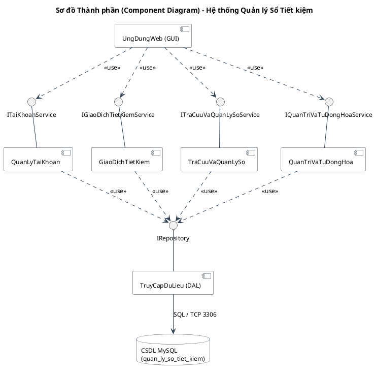

---

# PHẦN 2: SƠ ĐỒ TRIỂN KHAI (Deployment Diagram)

### 2.1. Danh mục các Node & Artifacts Kiến trúc Chuẩn (Khớp Slide 7)

| Node Triển khai | Kiểu Node (Stereotype) | Môi trường Thực thi / Thành phần bên trong | Artifacts / Mô tả Triển khai |
| :--- | :--- | :--- | :--- |
| **Máy trạm giao dịch viên** | `«device»`<br>PC Windows tại quầy | • `«artifact» UngDungGiaoDichVien.exe`<br>• `«device» Máy quét CCCD / mã vạch` (nối qua cổng `USB`) | Ứng dụng máy trạm chuyên dụng cho giao dịch viên tại quầy ngân hàng. |
| **Máy tra cứu / Điện thoại KH** | `«device»`<br>Máy tính cá nhân / Smartphone | `«execution environment» Trình duyệt web` | Khách hàng sử dụng trình duyệt truy cập cổng giao dịch trực tuyến. |
| **Máy chủ ứng dụng** | `«device»`<br>Application Server | Chứa toàn bộ các thành phần nghiệp vụ (BUS), truy cập dữ liệu (DAL) và web app: | • `«artifact» QuanLyTietKiem.dll / MoSo.dll (BUS)`<br>• `«artifact» TruyCapDuLieu.dll (DAL)`<br>• `«artifact» CongTraCuu (web app)` |
| **Máy chủ CSDL** | `«device»`<br>Database Server | `«execution environment» DBMS` | `+ CSDL quan_ly_so_tiet_kiem` |

### 2.2. Đường truyền & Giao thức Kết nối

| Kết nối (Connection Path) | Giao thức Mạng / Cổng | Chức năng Truyền thông |
| :--- | :--- | :--- |
| **Máy trạm giao dịch viên $\longleftrightarrow$ Máy quét CCCD / mã vạch** | `USB` | Kết nối thiết bị ngoại vi quét CCCD định danh khách hàng tại quầy. |
| **Máy trạm giao dịch viên $\longleftrightarrow$ Máy chủ ứng dụng** | `LAN, TCP/IP` | Giao dịch viên thực hiện mở sổ, lập phiếu tại quầy nội bộ. |
| **Máy tra cứu / Khách hàng $\longleftrightarrow$ Máy chủ ứng dụng** | `Internet, HTTPS` | Khách hàng truy cập ứng dụng web tra cứu và mở sổ online. |
| **Máy chủ ứng dụng $\longleftrightarrow$ Máy chủ CSDL** | `LAN, cổng DBMS` | Máy chủ ứng dụng truy vấn và cập nhật dữ liệu vào CSDL. |

### 2.3. Mã PlantUML Sơ đồ Triển khai

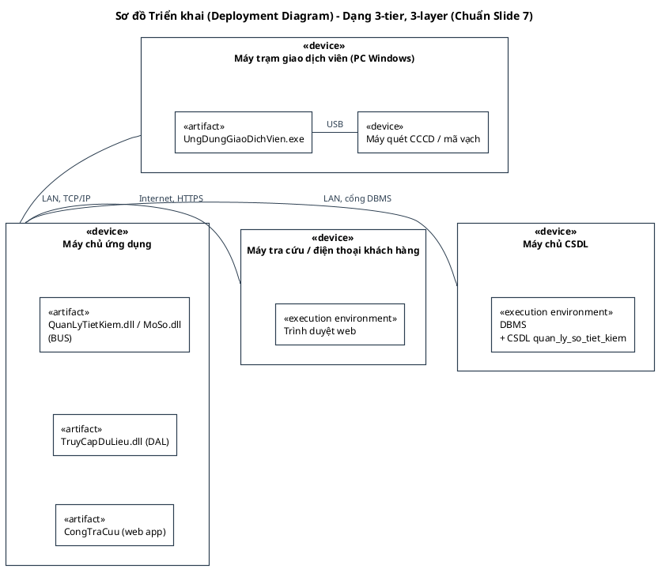

---

# PHẦN 3: SƠ ĐỒ CỘNG TÁC (Communication Diagrams — 17 Use Case)

## 3.1. FR-01: Đăng nhập & Xác thực

**Danh sách Đối tượng Tham gia:**

| Tầng | Tên Đối tượng trong Sơ đồ | Lớp (Class) tương ứng | Vai trò trong Use Case FR-01 |
| :--- | :--- | :--- | :--- |
| **Actor** | `Người dùng` | Khách hàng / Nhân viên / Quản lý | Tác nhân nhập tài khoản và mật khẩu đăng nhập hệ thống. |
| **GUI** | `:GiaoDienDangNhap` | `GiaoDienDangNhap` (Boundary) | Thu thập thông tin đăng nhập, hiển thị lỗi hoặc chuyển hướng giao diện theo quyền. |
| **BLL** | `:DieuKhienDangNhap` | `DieuKhienDangNhap` (Control) | Kiểm tra thông tin tài khoản, trạng thái khóa và khởi tạo phiên làm việc. |
| **DAL** | `:DuLieuTaiKhoan` | `TaiKhoanDAO` / `DuLieuTaiKhoan` | Truy xuất thông tin và trạng thái tài khoản từ bảng `TAI_KHOAN_DANG_NHAP`. |

**Bảng Truy vết Luồng Thông điệp (`docs/Sequence/FR 01.png`):**

| Thứ tự | Đối tượng gửi $\rightarrow$ Đối tượng nhận | Tên thông điệp / Phương thức | Ý nghĩa nghiệp vụ |
| :---: | :--- | :--- | :--- |
| **1** | `Người dùng` $\rightarrow$ `:GiaoDienDangNhap` | `nhapThongTin(tenDangNhap, matKhau)` | Người dùng nhập tài khoản và mật khẩu trên form. |
| **2** | `:GiaoDienDangNhap` $\rightarrow$ `:DieuKhienDangNhap` | `yeuCauXacThuc(tenDangNhap, matKhau)` | GUI gửi thông tin đăng nhập sang BLL xác thực. |
| **3** | `:DieuKhienDangNhap` $\rightarrow$ `:DuLieuTaiKhoan` | `layThongTinTaiKhoan(tenDangNhap)` | BLL yêu cầu DAL đọc thông tin tài khoản. |
| **4** | `:DuLieuTaiKhoan` $\rightarrow$ `:DieuKhienDangNhap` | `traVe(thongTinTaiKhoan)` | DAL trả về thông tin tài khoản (mật khẩu băm, vai trò). |
| **5a** | `:DieuKhienDangNhap` $\rightarrow$ `:GiaoDienDangNhap` | `traVeLoi("Sai thông tin")` | *[Tài khoản rỗng hoặc sai mật khẩu]* BLL trả thông báo lỗi. |
| **6a** | `:GiaoDienDangNhap` $\rightarrow$ `Người dùng` | `hienThiLoi()` | GUI hiển thị lỗi đăng nhập lên màn hình. |
| **5b** | `:DieuKhienDangNhap` $\rightarrow$ `:DuLieuTaiKhoan` | `kiemTraTrangThai(tenDangNhap)` | *[Đúng thông tin]* BLL kiểm tra trạng thái tài khoản. |
| **6b** | `:DuLieuTaiKhoan` $\rightarrow$ `:DieuKhienDangNhap` | `traVe(trangThai)` | DAL trả về trạng thái tài khoản. |
| **7b1** | `:DieuKhienDangNhap` $\rightarrow$ `:GiaoDienDangNhap` | `traVeLoi("Tài khoản bị khóa")` | *[trangThai == "Bị khóa"]* BLL từ chối truy cập. |
| **8b1** | `:GiaoDienDangNhap` $\rightarrow$ `Người dùng` | `hienThiLoi()` | GUI hiển thị thông báo tài khoản bị khóa. |
| **7b2** | `:DieuKhienDangNhap` $\rightarrow$ `:DieuKhienDangNhap` | `taoPhienLamViec(Phiên)` | *[trangThai == "Hoạt động"]* BLL khởi tạo phiên làm việc. |
| **8b2** | `:DieuKhienDangNhap` $\rightarrow$ `:GiaoDienDangNhap` | `traVeThanhCong(Quyen)` | BLL trả về kết quả thành công kèm quyền hạn. |
| **9b2** | `:GiaoDienDangNhap` $\rightarrow$ `Người dùng` | `chuyenHuongTrangChu(Quyen)` | GUI điều hướng người dùng tới trang chủ tương ứng vai trò. |

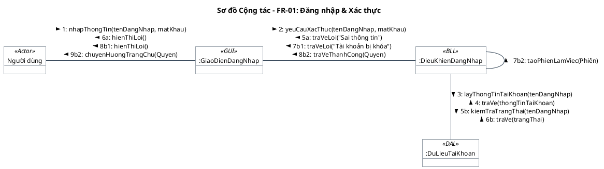

## 3.2. FR-02: Quản lý thông tin cá nhân

**Danh sách Đối tượng Tham gia:**

| Tầng | Tên Đối tượng trong Sơ đồ | Lớp (Class) tương ứng | Vai trò trong Use Case FR-02 |
| :--- | :--- | :--- | :--- |
| **Actor** | `Người dùng` | Khách hàng / Nhân viên | Tác nhân xem và cập nhật thông tin cá nhân. |
| **GUI** | `:GiaoDienThongTinCaNhan` | `GiaoDienThongTinCaNhan` (Boundary) | Hiển thị hồ sơ hiện tại, tiếp nhận dữ liệu sửa đổi và báo kết quả. |
| **BLL** | `:DieuKhienNguoiDung` | `DieuKhienNguoiDung` (Control) | Kiểm tra tính hợp lệ dữ liệu cá nhân (Email, SĐT, CCCD) và điều phối cập nhật. |
| **DAL** | `:DuLieuHoSo` | `HoSoDAO` / `DuLieuHoSo` | Đọc và cập nhật các bảng `NGUOI_DUNG`, `HO_SO_KHACH_HANG`. |

**Bảng Truy vết Luồng Thông điệp (`docs/Sequence/FR 02.png`):**

| Thứ tự | Đối tượng gửi $\rightarrow$ Đối tượng nhận | Tên thông điệp / Phương thức | Ý nghĩa nghiệp vụ |
| :---: | :--- | :--- | :--- |
| **1** | `Người dùng` $\rightarrow$ `:GiaoDienThongTinCaNhan` | `chonXemThongTin()` | Người dùng mở màn hình hồ sơ cá nhân. |
| **2** | `:GiaoDienThongTinCaNhan` $\rightarrow$ `:DieuKhienNguoiDung` | `yeuCauLayThongTin(maNguoiDung)` | GUI yêu cầu BLL lấy thông tin hồ sơ hiện tại. |
| **3** | `:DieuKhienNguoiDung` $\rightarrow$ `:DuLieuHoSo` | `truyVanHoSo(maNguoiDung)` | BLL gọi DAL truy vấn dữ liệu hồ sơ. |
| **4** | `:DuLieuHoSo` $\rightarrow$ `:DieuKhienNguoiDung` | `traVe(duLieuHoSo)` | DAL trả về thông tin hồ sơ. |
| **5** | `:DieuKhienNguoiDung` $\rightarrow$ `:GiaoDienThongTinCaNhan` | `traVe(duLieuHoSo)` | BLL chuyển dữ liệu hồ sơ lên GUI. |
| **6** | `:GiaoDienThongTinCaNhan` $\rightarrow$ `Người dùng` | `hienThiHoSo(duLieuHoSo)` | GUI hiển thị hồ sơ hiện tại lên màn hình. |
| **7** | `Người dùng` $\rightarrow$ `:GiaoDienThongTinCaNhan` | `nhapThongTinCapNhat(duLieuMoi)` | Người dùng chỉnh sửa thông tin và bấm lưu. |
| **8** | `:GiaoDienThongTinCaNhan` $\rightarrow$ `:DieuKhienNguoiDung` | `yeuCauCapNhatThongTin(duLieuMoi)` | GUI gửi dữ liệu mới sang BLL. |
| **9** | `:DieuKhienNguoiDung` $\rightarrow$ `:DieuKhienNguoiDung` | `kiemTraTinhHopLe(duLieuMoi)` | BLL kiểm tra quy tắc định dạng dữ liệu mới. |
| **10a** | `:DieuKhienNguoiDung` $\rightarrow$ `:GiaoDienThongTinCaNhan` | `traVeLoi("Lỗi định dạng")` | *[Dữ liệu không hợp lệ]* BLL trả lỗi định dạng. |
| **11a** | `:GiaoDienThongTinCaNhan` $\rightarrow$ `Người dùng` | `hienThiLoi()` | GUI hiển thị thông báo lỗi. |
| **10b** | `:DieuKhienNguoiDung` $\rightarrow$ `:DuLieuHoSo` | `capNhatHoSo(maNguoiDung, duLieuMoi)` | *[Dữ liệu hợp lệ]* BLL yêu cầu DAL lưu hồ sơ mới. |
| **11b** | `:DuLieuHoSo` $\rightarrow$ `:DieuKhienNguoiDung` | `thanhCong` | DAL xác nhận cập nhật thành công. |
| **12** | `:DieuKhienNguoiDung` $\rightarrow$ `:GiaoDienThongTinCaNhan` | `traVeThanhCong` | BLL báo hoàn tất cập nhật cho GUI. |
| **13** | `:GiaoDienThongTinCaNhan` $\rightarrow$ `Người dùng` | `hienThiThanhCong()` | GUI hiển thị thông báo lưu thành công. |

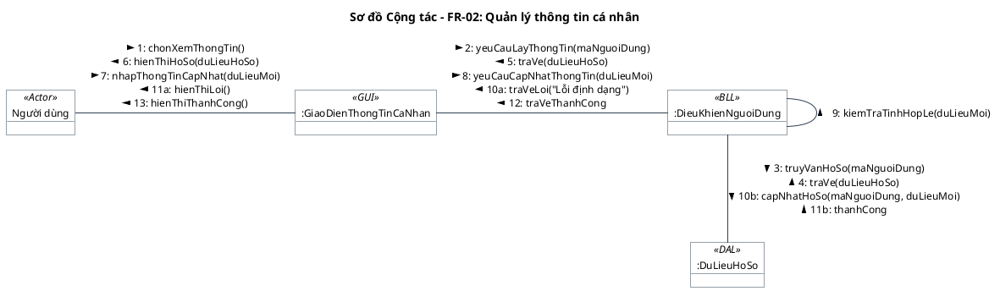

## 3.3. FR-03: Mở sổ tiết kiệm online

**Danh sách Đối tượng Tham gia:**

| Tầng | Tên Đối tượng trong Sơ đồ | Lớp (Class) tương ứng | Vai trò trong Use Case FR-03 |
| :--- | :--- | :--- | :--- |
| **Actor** | `Khách hàng` | Người dùng đóng vai trò Khách hàng | Tác nhân thực hiện thao tác mở sổ online. |
| **GUI** | `:GiaoDienMoSoOnline` | `GiaoDienMoSoOnline` (Boundary) | Thu thập thông tin mở sổ và hiển thị kết quả/lỗi. |
| **BLL** | `:DieuKhienGiaoDich` | `DieuKhienGiaoDich` (Control) | Kiểm tra số dư, điều phối Transaction trừ tiền, tạo sổ và kích hoạt thông báo. |
| **DAL** | `:DuLieuTaiKhoan` | `TaiKhoanDAO` / `DuLieuTaiKhoan` | Kiểm tra số dư và trừ tiền bảng `TAI_KHOAN_THANH_TOAN`. |
| **DAL** | `:DuLieuSoTietKiem` | `SoTietKiemDAO` / `DuLieuSoTietKiem` | Ghi `SO_TIET_KIEM`, `CHU_KY_SO_TIET_KIEM`, `GIAO_DICH_TIET_KIEM`. |

**Bảng Truy vết Luồng Thông điệp (`docs/Sequence/FR 03.png`):**

| Thứ tự | Đối tượng gửi $\rightarrow$ Đối tượng nhận | Tên thông điệp / Phương thức | Ý nghĩa nghiệp vụ |
| :---: | :--- | :--- | :--- |
| **1** | `Khách hàng` $\rightarrow$ `:GiaoDienMoSoOnline` | `nhapThongTin(soTien, kyHan, phuongThucTaiTuc)` | Khách hàng điền biểu mẫu mở sổ trên giao diện. |
| **2** | `:GiaoDienMoSoOnline` $\rightarrow$ `:DieuKhienGiaoDich` | `yeuCauMoSo(thongTin)` | GUI gửi yêu cầu mở sổ sang BLL. |
| **3** | `:DieuKhienGiaoDich` $\rightarrow$ `:DuLieuTaiKhoan` | `kiemTraSoDu(maKhachHang)` | BLL yêu cầu DAL đọc số dư tài khoản thanh toán. |
| **4** | `:DuLieuTaiKhoan` $\rightarrow$ `:DieuKhienGiaoDich` | `traVe(soDu)` | DAL trả về số dư thực tế. |
| **5a** | `:DieuKhienGiaoDich` $\rightarrow$ `:GiaoDienMoSoOnline` | `traVeLoi("Số dư không đủ")` | *[soDu < soTien]* BLL từ chối mở sổ. |
| **6a** | `:GiaoDienMoSoOnline` $\rightarrow$ `Khách hàng` | `hienThiLoi()` | GUI hiển thị lỗi lên màn hình. |
| **5b** | `:DieuKhienGiaoDich` $\rightarrow$ `:DuLieuTaiKhoan` | `truTienThanhToan(maKhachHang, soTien)` | *[soDu >= soTien]* BLL yêu cầu trừ số dư tài khoản nguồn. |
| **6b** | `:DuLieuTaiKhoan` $\rightarrow$ `:DieuKhienGiaoDich` | `thanhCong` | DAL xác nhận đã trừ tiền thành công. |
| **7b** | `:DieuKhienGiaoDich` $\rightarrow$ `:DuLieuSoTietKiem` | `taoBanGhiSoMoi(thongTin)` | BLL yêu cầu DAL ghi sổ mới, chu kỳ và giao dịch. |
| **8b** | `:DuLieuSoTietKiem` $\rightarrow$ `:DieuKhienGiaoDich` | `traVe(maSoMoi)` | DAL trả về mã sổ vừa tạo. |
| **9b** | `:DieuKhienGiaoDich` $\rightarrow$ `:DieuKhienGiaoDich` | `kichHoatGuiThongBao(UC-EX02)` | BLL kích hoạt gửi Email/SMS xác nhận. |
| **10b** | `:DieuKhienGiaoDich` $\rightarrow$ `:GiaoDienMoSoOnline` | `traVeThanhCong(maSoMoi)` | BLL trả về mã sổ thành công cho GUI. |
| **11b** | `:GiaoDienMoSoOnline` $\rightarrow$ `Khách hàng` | `hienThiThanhCong()` | GUI hiển thị thông báo mở sổ thành công. |

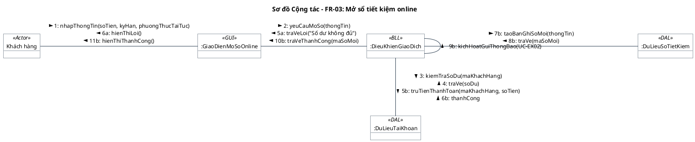

## 3.4. FR-04: Mở sổ tiết kiệm trực tiếp (tại quầy)

**Danh sách Đối tượng Tham gia:**

| Tầng | Tên Đối tượng trong Sơ đồ | Lớp (Class) tương ứng | Vai trò trong Use Case FR-04 |
| :--- | :--- | :--- | :--- |
| **Actor** | `Nhân viên` | Giao dịch viên tại quầy | Tác nhân tiếp nhận tiền mặt và thao tác mở sổ cho khách hàng. |
| **GUI** | `:GiaoDienMoSoTaiQuay` | `GiaoDienMoSoTaiQuay` (Boundary) | Nhập CCCD tìm khách, nhập tham số giao dịch và in chứng từ. |
| **BLL** | `:DieuKhienGiaoDich` | `DieuKhienGiaoDich` (Control) | Kiểm tra hồ sơ khách hàng, kiểm tra quy định nghiệp vụ và tạo sổ mới. |
| **DAL** | `:DuLieuKhachHang` | `KhachHangDAO` / `DuLieuKhachHang` | Truy xuất hồ sơ khách hàng từ `KHACH_HANG`, `HO_SO_KHACH_HANG`. |
| **DAL** | `:DuLieuSoTietKiem` | `SoTietKiemDAO` / `DuLieuSoTietKiem` | Ghi sổ tiết kiệm, chu kỳ 1 và giao dịch tại quầy vào CSDL. |

**Bảng Truy vết Luồng Thông điệp (`docs/Sequence/FR 04.png`):**

| Thứ tự | Đối tượng gửi $\rightarrow$ Đối tượng nhận | Tên thông điệp / Phương thức | Ý nghĩa nghiệp vụ |
| :---: | :--- | :--- | :--- |
| **1** | `Nhân viên` $\rightarrow$ `:GiaoDienMoSoTaiQuay` | `timKiemKhachHang(CCCD)` | Giao dịch viên nhập CCCD tìm hồ sơ khách. |
| **2** | `:GiaoDienMoSoTaiQuay` $\rightarrow$ `:DieuKhienGiaoDich` | `yeuCauTruyVanKH(CCCD)` | GUI yêu cầu BLL truy vấn hồ sơ khách hàng. |
| **3** | `:DieuKhienGiaoDich` $\rightarrow$ `:DuLieuKhachHang` | `layThongTinHoSo(CCCD)` | BLL gọi DAL tìm hồ sơ theo CCCD. |
| **4** | `:DuLieuKhachHang` $\rightarrow$ `:DieuKhienGiaoDich` | `traVe(thongTinKH)` | DAL trả về thông tin hồ sơ khách hàng. |
| **5** | `:DieuKhienGiaoDich` $\rightarrow$ `:GiaoDienMoSoTaiQuay` | `traVe(thongTinKH)` | BLL chuyển thông tin khách hàng về GUI. |
| **6** | `:GiaoDienMoSoTaiQuay` $\rightarrow$ `Nhân viên` | `hienThiThongTinKH()` | GUI hiển thị hồ sơ khách hàng lên màn hình. |
| **7** | `Nhân viên` $\rightarrow$ `:GiaoDienMoSoTaiQuay` | `nhapThongTinGiaoDich(soTien, kyHan)` | Nhân viên nhập số tiền gửi, kỳ hạn mở sổ. |
| **8** | `:GiaoDienMoSoTaiQuay` $\rightarrow$ `:DieuKhienGiaoDich` | `yeuCauMoSo(thongTin)` | GUI gửi yêu cầu mở sổ sang BLL. |
| **9** | `:DieuKhienGiaoDich` $\rightarrow$ `:DieuKhienGiaoDich` | `kiemTraDieuKienNghiepVu(thongTin)` | BLL kiểm tra hạn mức tối thiểu và điều kiện kỳ hạn. |
| **10a** | `:DieuKhienGiaoDich` $\rightarrow$ `:GiaoDienMoSoTaiQuay` | `traVeLoi("Sai quy định")` | *[Không hợp lệ / Thiếu thông tin]* BLL trả lỗi. |
| **11a** | `:GiaoDienMoSoTaiQuay` $\rightarrow$ `Nhân viên` | `hienThiLoi()` | GUI thông báo lỗi cho nhân viên. |
| **10b** | `:DieuKhienGiaoDich` $\rightarrow$ `:DuLieuSoTietKiem` | `taoBanGhiSoMoi(thongTin)` | *[Hợp lệ]* BLL yêu cầu DAL tạo bản ghi sổ mới. |
| **11b** | `:DuLieuSoTietKiem` $\rightarrow$ `:DieuKhienGiaoDich` | `traVe(maSoMoi)` | DAL trả về mã sổ vừa khởi tạo. |
| **12b** | `:DieuKhienGiaoDich` $\rightarrow$ `:GiaoDienMoSoTaiQuay` | `traVeThanhCong(maSoMoi)` | BLL thông báo hoàn tất giao dịch cho GUI. |
| **13b** | `:GiaoDienMoSoTaiQuay` $\rightarrow$ `Nhân viên` | `yeuCauInChungTu()` | GUI hiển thị chứng từ / sổ vật lý để in. |

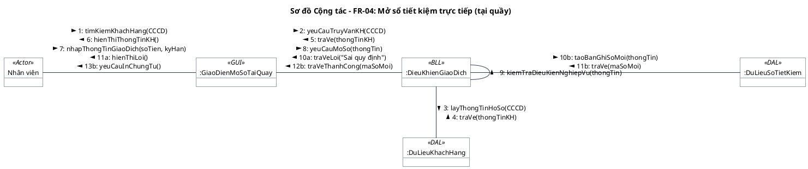

## 3.5. FR-05: Tra cứu thông tin sổ

**Danh sách Đối tượng Tham gia:**

| Tầng | Tên Đối tượng trong Sơ đồ | Lớp (Class) tương ứng | Vai trò trong Use Case FR-05 |
| :--- | :--- | :--- | :--- |
| **Actor** | `Người dùng` | Khách hàng / Nhân viên / Quản lý | Tác nhân nhập từ khóa tra cứu sổ tiết kiệm. |
| **GUI** | `:GiaoDienTraCuu` | `GiaoDienTraCuu` (Boundary) | Nhập tiêu chí (Mã sổ / CCCD) và hiển thị kết quả hoặc thông báo rỗng. |
| **BLL** | `:DieuKhienTraCuu` | `DieuKhienTraCuu` (Control) | Kiểm tra quyền, truy vấn danh sách sổ và gọi tính lãi (UC-06). |
| **DAL** | `:DuLieuSoTietKiem` | `SoTietKiemDAO` / `DuLieuSoTietKiem` | Truy vấn bảng `SO_TIET_KIEM`, `CHU_KY_SO_TIET_KIEM`, `BIEU_LAI_SUAT`. |

**Bảng Truy vết Luồng Thông điệp (`docs/Sequence/FR 05.png`):**

| Thứ tự | Đối tượng gửi $\rightarrow$ Đối tượng nhận | Tên thông điệp / Phương thức | Ý nghĩa nghiệp vụ |
| :---: | :--- | :--- | :--- |
| **1** | `Người dùng` $\rightarrow$ `:GiaoDienTraCuu` | `nhapTieuChi(tuKhoa)` | Người dùng nhập mã sổ hoặc CCCD để tra cứu. |
| **2** | `:GiaoDienTraCuu` $\rightarrow$ `:DieuKhienTraCuu` | `yeuCauTraCuu(tuKhoa)` | GUI chuyển tiêu chí tìm kiếm sang BLL. |
| **3** | `:DieuKhienTraCuu` $\rightarrow$ `:DuLieuSoTietKiem` | `truyVanSoTietKiem(tuKhoa)` | BLL gọi DAL tìm kiếm thông tin sổ. |
| **4** | `:DuLieuSoTietKiem` $\rightarrow$ `:DieuKhienTraCuu` | `traVe(danhSachSo)` | DAL trả về danh sách sổ phù hợp. |
| **5a** | `:DieuKhienTraCuu` $\rightarrow$ `:GiaoDienTraCuu` | `traVeLoi("Không có dữ liệu")` | *[Không tìm thấy dữ liệu]* BLL trả thông báo không tìm thấy. |
| **6a** | `:GiaoDienTraCuu` $\rightarrow$ `Người dùng` | `hienThiThongBao()` | GUI hiển thị thông báo "Không tìm thấy dữ liệu". |
| **5b** | `:DieuKhienTraCuu` $\rightarrow$ `:DieuKhienTraCuu` | `goiUCTinhLai(UC-06)` | *[Tìm thấy dữ liệu]* BLL gọi tính tiền lãi tạm tính. |
| **6b** | `:DieuKhienTraCuu` $\rightarrow$ `:GiaoDienTraCuu` | `traVe(danhSachSo, tienLai)` | BLL trả danh sách sổ kèm tiền lãi lên GUI. |
| **7b** | `:GiaoDienTraCuu` $\rightarrow$ `Người dùng` | `hienThiKetQua()` | GUI hiển thị chi tiết sổ và tiền lãi cho người dùng. |

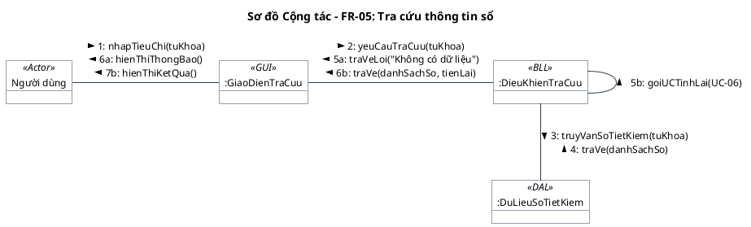

## 3.6. FR-06: Tính & Tra cứu tiền lãi

**Danh sách Đối tượng Tham gia:**

| Tầng | Tên Đối tượng trong Sơ đồ | Lớp (Class) tương ứng | Vai trò trong Use Case FR-06 |
| :--- | :--- | :--- | :--- |
| **GUI / Caller** | `:GiaoDien / HeThong` | Giao diện tính lãi hoặc Use Case gọi (`FR-05`, `FR-07`) | Bên gọi cung cấp thông số (tiền gốc, kỳ hạn, ngày gửi) và nhận tiền lãi. |
| **BLL** | `:DieuKhienTinhLai` | `DieuKhienTinhLai` (Control) | Kiểm tra tính hợp lý tham số, áp dụng công thức tính lãi ngân hàng. |
| **DAL** | `:DuLieuLaiSuat` | `BieuLaiSuatDAO` / `DuLieuLaiSuat` | Đọc biểu lãi suất hiện hành từ `BIEU_LAI_SUAT`, `KY_HAN_TIET_KIEM`. |

**Bảng Truy vết Luồng Thông điệp (`docs/Sequence/FR 06.png`):**

| Thứ tự | Đối tượng gửi $\rightarrow$ Đối tượng nhận | Tên thông điệp / Phương thức | Ý nghĩa nghiệp vụ |
| :---: | :--- | :--- | :--- |
| **1** | `:GiaoDien / HeThong` $\rightarrow$ `:DieuKhienTinhLai` | `truyenThongSo(soTien, kyHan, ngayGui)` | Truyền thông số cần tính lãi sang BLL. |
| **2** | `:DieuKhienTinhLai` $\rightarrow$ `:DieuKhienTinhLai` | `kiemTraTinhHopLy(thongSo)` | BLL kiểm tra gốc > 0, kỳ hạn $\ge$ 0, thời gian gửi hợp lệ. |
| **3a** | `:DieuKhienTinhLai` $\rightarrow$ `:GiaoDien / HeThong` | `traVeLoi("Tham số sai")` | *[Dữ liệu không hợp lệ]* BLL báo lỗi tham số. |
| **3b** | `:DieuKhienTinhLai` $\rightarrow$ `:DuLieuLaiSuat` | `layLaiSuatHienHanh(kyHan)` | *[Dữ liệu hợp lệ]* BLL yêu cầu DAL lấy lãi suất kỳ hạn. |
| **4b** | `:DuLieuLaiSuat` $\rightarrow$ `:DieuKhienTinhLai` | `traVe(mucLaiSuat)` | DAL trả về mức lãi suất năm áp dụng. |
| **5b** | `:DieuKhienTinhLai` $\rightarrow$ `:DieuKhienTinhLai` | `apDungCongThucTinhLai()` | BLL thực thi công thức tính lãi theo ngày thực gửi / kỳ hạn. |
| **6b** | `:DieuKhienTinhLai` $\rightarrow$ `:GiaoDien / HeThong` | `traVe(soTienLai)` | BLL trả về kết quả tiền lãi cho bên gọi. |

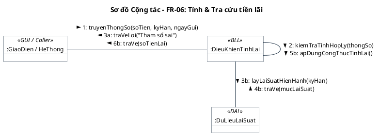

## 3.7. FR-07: Tất toán sổ tiết kiệm

**Danh sách Đối tượng Tham gia:**

| Tầng | Tên Đối tượng trong Sơ đồ | Lớp (Class) tương ứng | Vai trò trong Use Case FR-07 |
| :--- | :--- | :--- | :--- |
| **Actor** | `Người dùng` | Khách hàng / Nhân viên giao dịch | Tác nhân chọn sổ cần tất toán và bấm xác nhận thực hiện. |
| **GUI** | `:GiaoDienTatToan` | `GiaoDienTatToan` (Boundary) | Hiển thị gốc, lãi tất toán, nhận xác nhận và xuất biên nhận. |
| **BLL** | `:DieuKhienTatToan` | `DieuKhienTatToan` (Control) | Kiểm tra ngày đáo hạn, kích hoạt `UC-EX03` nếu trước hạn, tính lãi và xử lý giao dịch. |
| **DAL** | `:DuLieuSoTietKiem` | `SoTietKiemDAO` / `DuLieuSoTietKiem` | Lấy thông tin sổ và cập nhật trạng thái sổ sang `"Đã tất toán"`. |
| **DAL** | `:DuLieuTaiKhoan` | `TaiKhoanDAO` / `DuLieuTaiKhoan` | Cộng tiền gốc + lãi vào tài khoản thanh toán nguồn (`TAI_KHOAN_THANH_TOAN`). |

**Bảng Truy vết Luồng Thông điệp (`docs/Sequence/FR 07.png`):**

| Thứ tự | Đối tượng gửi $\rightarrow$ Đối tượng nhận | Tên thông điệp / Phương thức | Ý nghĩa nghiệp vụ |
| :---: | :--- | :--- | :--- |
| **1** | `Người dùng` $\rightarrow$ `:GiaoDienTatToan` | `chonSoCanTatToan(maSo)` | Người dùng chọn sổ tiết kiệm muốn tất toán. |
| **2** | `:GiaoDienTatToan` $\rightarrow$ `:DieuKhienTatToan` | `yeuCauTatToan(maSo)` | GUI gửi yêu cầu kiểm tra tất toán sang BLL. |
| **3** | `:DieuKhienTatToan` $\rightarrow$ `:DuLieuSoTietKiem` | `layThongTinSo(maSo)` | BLL gọi DAL lấy chi tiết sổ và ngày đáo hạn. |
| **4** | `:DuLieuSoTietKiem` $\rightarrow$ `:DieuKhienTatToan` | `traVe(thongTinSo, ngayDaoHan)` | DAL trả về dữ liệu sổ tiết kiệm. |
| **5** | `:DieuKhienTatToan` $\rightarrow$ `:DieuKhienTatToan` | `kiemTraNgayDaoHan()` | BLL đối chiếu ngày tất toán với ngày đáo hạn. |
| **6a** | `:DieuKhienTatToan` $\rightarrow$ `:DieuKhienTatToan` | `kichHoatNgoaiLe(UC-EX03)` | *[Chưa đến hạn]* BLL chuyển sang luồng Tất toán trước hạn (`EX-03`). |
| **6b** | `:DieuKhienTatToan` $\rightarrow$ `:DieuKhienTatToan` | `tinhLaiDungHan()` | *[Đúng hạn]* BLL tính tiền lãi nhận đúng hạn. |
| **7b** | `:DieuKhienTatToan` $\rightarrow$ `:GiaoDienTatToan` | `hienThiSoTien(goc, lai)` | BLL trả số tiền gốc + lãi lên GUI hiển thị. |
| **8** | `Người dùng` $\rightarrow$ `:GiaoDienTatToan` | `xacNhanThucHienTatToan()` | Người dùng bấm xác nhận thực hiện tất toán. |
| **9** | `:GiaoDienTatToan` $\rightarrow$ `:DieuKhienTatToan` | `thucHienTatToan()` | GUI gửi lệnh thực thi tất toán sang BLL. |
| **10** | `:DieuKhienTatToan` $\rightarrow$ `:DuLieuSoTietKiem` | `capNhatTrangThai("Đã tất toán")` | BLL yêu cầu DAL chuyển trạng thái sổ. |
| **11** | `:DuLieuSoTietKiem` $\rightarrow$ `:DieuKhienTatToan` | `thanhCong` | DAL xác nhận đã cập nhật trạng thái sổ. |
| **12** | `:DieuKhienTatToan` $\rightarrow$ `:DuLieuTaiKhoan` | `congTienVaoTaiKhoan(goc + lai)` | BLL yêu cầu DAL cộng gốc + lãi vào tài khoản thanh toán. |
| **13** | `:DuLieuTaiKhoan` $\rightarrow$ `:DieuKhienTatToan` | `thanhCong` | DAL xác nhận cộng tiền thành công. |
| **14** | `:DieuKhienTatToan` $\rightarrow$ `:GiaoDienTatToan` | `traVeThanhCong` | BLL báo hoàn tất tất toán cho GUI. |
| **15** | `:GiaoDienTatToan` $\rightarrow$ `Người dùng` | `hienThiThanhCong()` | GUI xuất phiếu / biên nhận tất toán thành công. |

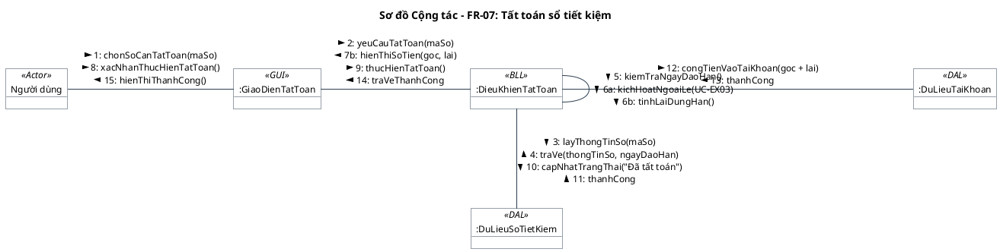

## 3.8. FR-08: Quản lý thông tin khách hàng

**Danh sách Đối tượng Tham gia:**

| Tầng | Tên Đối tượng trong Sơ đồ | Lớp (Class) tương ứng | Vai trò trong Use Case FR-08 |
| :--- | :--- | :--- | :--- |
| **Actor** | `Nhân viên / Quản lý` | Giao dịch viên / Kiểm soát viên | Tác nhân tra cứu danh sách và thêm mới/cập nhật hồ sơ khách hàng. |
| **GUI** | `:GiaoDienKhachHang` | `GiaoDienKhachHang` (Boundary) | Hiển thị danh sách, tiếp nhận dữ liệu nhập/sửa và thông báo kết quả. |
| **BLL** | `:DieuKhienKhachHang` | `DieuKhienKhachHang` (Control) | Kiểm tra định dạng và tính duy nhất CCCD trước khi cập nhật. |
| **DAL** | `:DuLieuKhachHang` | `KhachHangDAO` / `DuLieuKhachHang` | Truy vấn và cập nhật `NGUOI_DUNG`, `KHACH_HANG`, `HO_SO_KHACH_HANG`. |

**Bảng Truy vết Luồng Thông điệp (`docs/Sequence/FR 08.png`):**

| Thứ tự | Đối tượng gửi $\rightarrow$ Đối tượng nhận | Tên thông điệp / Phương thức | Ý nghĩa nghiệp vụ |
| :---: | :--- | :--- | :--- |
| **1** | `Nhân viên / Quản lý` $\rightarrow$ `:GiaoDienKhachHang` | `chonTraCuuDanhSach()` | Mở chức năng quản lý danh sách khách hàng. |
| **2** | `:GiaoDienKhachHang` $\rightarrow$ `:DieuKhienKhachHang` | `yeuCauLayDanhSach()` | GUI yêu cầu BLL lấy danh sách khách hàng. |
| **3** | `:DieuKhienKhachHang` $\rightarrow$ `:DuLieuKhachHang` | `truyVanToanBo()` | BLL yêu cầu DAL đọc dữ liệu khách hàng. |
| **4** | `:DuLieuKhachHang` $\rightarrow$ `:DieuKhienKhachHang` | `traVe(danhSachKH)` | DAL trả về danh sách khách hàng. |
| **5** | `:DieuKhienKhachHang` $\rightarrow$ `:GiaoDienKhachHang` | `traVe(danhSachKH)` | BLL trả danh sách lên GUI. |
| **6** | `:GiaoDienKhachHang` $\rightarrow$ `Nhân viên / Quản lý` | `hienThiDanhSach()` | GUI hiển thị danh sách khách hàng. |
| **7** | `Nhân viên / Quản lý` $\rightarrow$ `:GiaoDienKhachHang` | `luuThongTin(thongTinKH)` | Nhập mới / chỉnh sửa thông tin và nhấn lưu. |
| **8** | `:GiaoDienKhachHang` $\rightarrow$ `:DieuKhienKhachHang` | `yeuCauLuu(thongTinKH)` | GUI gửi dữ liệu khách hàng sang BLL. |
| **9** | `:DieuKhienKhachHang` $\rightarrow$ `:DieuKhienKhachHang` | `kiemTraDuLieu()` | BLL kiểm tra định dạng và trùng lặp CCCD. |
| **10a** | `:DieuKhienKhachHang` $\rightarrow$ `:GiaoDienKhachHang` | `traVeLoi("Dữ liệu không hợp lệ")` | *[Trùng lặp / Sai định dạng]* BLL trả thông báo lỗi. |
| **11a** | `:GiaoDienKhachHang` $\rightarrow$ `Nhân viên / Quản lý` | `hienThiLoi()` | GUI hiển thị lỗi trên màn hình. |
| **10b** | `:DieuKhienKhachHang` $\rightarrow$ `:DuLieuKhachHang` | `capNhatCSDL(thongTinKH)` | *[Hợp lệ]* BLL yêu cầu DAL lưu vào CSDL. |
| **11b** | `:DuLieuKhachHang` $\rightarrow$ `:DieuKhienKhachHang` | `thanhCong` | DAL xác nhận lưu thành công. |
| **12** | `:DieuKhienKhachHang` $\rightarrow$ `:GiaoDienKhachHang` | `traVeThanhCong` | BLL báo thành công về GUI. |
| **13** | `:GiaoDienKhachHang` $\rightarrow$ `Nhân viên / Quản lý` | `hienThiThanhCong()` | GUI thông báo ghi nhận / cập nhật thành công. |

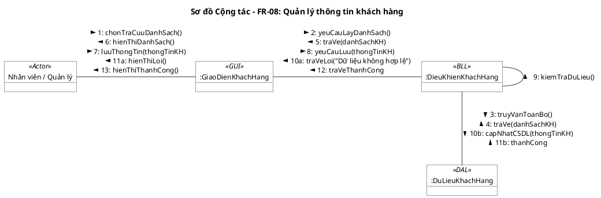

## 3.9. FR-09: Quản lý thông tin & trạng thái sổ

**Danh sách Đối tượng Tham gia:**

| Tầng | Tên Đối tượng trong Sơ đồ | Lớp (Class) tương ứng | Vai trò trong Use Case FR-09 |
| :--- | :--- | :--- | :--- |
| **Actor** | `Người dùng` | Nhân viên / Quản lý | Tác nhân tra cứu sổ và thực hiện phong tỏa / báo mất / giải tỏa sổ. |
| **GUI** | `:GiaoDienTrangThaiSo` | `GiaoDienTrangThaiSo` (Boundary) | Nhập mã sổ tra cứu, chọn trạng thái mới và hiển thị kết quả. |
| **BLL** | `:DieuKhienSoTietKiem` | `DieuKhienSoTietKiem` (Control) | Đối chiếu quy tắc chuyển đổi trạng thái hợp lệ của sổ tiết kiệm. |
| **DAL** | `:DuLieuSoTietKiem` | `SoTietKiemDAO` / `DuLieuSoTietKiem` | Đọc chi tiết sổ và cập nhật bảng `SO_TIET_KIEM`, `LICH_SU_TRANG_THAI_SO`. |

**Bảng Truy vết Luồng Thông điệp (`docs/Sequence/FR 09.png`):**

| Thứ tự | Đối tượng gửi $\rightarrow$ Đối tượng nhận | Tên thông điệp / Phương thức | Ý nghĩa nghiệp vụ |
| :---: | :--- | :--- | :--- |
| **1** | `Người dùng` $\rightarrow$ `:GiaoDienTrangThaiSo` | `traCuuSo(maSo)` | Người dùng nhập mã sổ cần xử lý. |
| **2** | `:GiaoDienTrangThaiSo` $\rightarrow$ `:DieuKhienSoTietKiem` | `yeuCauTraCuu(maSo)` | GUI yêu cầu BLL lấy chi tiết sổ. |
| **3** | `:DieuKhienSoTietKiem` $\rightarrow$ `:DuLieuSoTietKiem` | `layChiTietSo(maSo)` | BLL gọi DAL truy vấn thông tin sổ. |
| **4** | `:DuLieuSoTietKiem` $\rightarrow$ `:DieuKhienSoTietKiem` | `traVe(chiTietSo)` | DAL trả về thông tin và trạng thái hiện tại. |
| **5** | `:DieuKhienSoTietKiem` $\rightarrow$ `:GiaoDienTrangThaiSo` | `traVe(chiTietSo)` | BLL gửi chi tiết sổ về GUI. |
| **6** | `:GiaoDienTrangThaiSo` $\rightarrow$ `Người dùng` | `hienThiChiTietSo()` | GUI hiển thị thông tin và trạng thái sổ hiện tại. |
| **7** | `Người dùng` $\rightarrow$ `:GiaoDienTrangThaiSo` | `chonCapNhatTrangThai(trangThaiMoi)` | Người dùng chọn trạng thái mới (Phong tỏa / Báo mất / Giải tỏa). |
| **8** | `:GiaoDienTrangThaiSo` $\rightarrow$ `:DieuKhienSoTietKiem` | `yeuCauCapNhat(maSo, trangThaiMoi)` | GUI gửi yêu cầu đổi trạng thái sang BLL. |
| **9** | `:DieuKhienSoTietKiem` $\rightarrow$ `:DieuKhienSoTietKiem` | `kiemTraDieuKien()` | BLL đối chiếu logic chuyển đổi trạng thái. |
| **10a** | `:DieuKhienSoTietKiem` $\rightarrow$ `:GiaoDienTrangThaiSo` | `traVeLoi("Trạng thái không hợp lệ")` | *[Không thỏa điều kiện]* BLL từ chối cập nhật. |
| **11a** | `:GiaoDienTrangThaiSo` $\rightarrow$ `Người dùng` | `hienThiLoi()` | GUI hiển thị lý do từ chối. |
| **10b** | `:DieuKhienSoTietKiem` $\rightarrow$ `:DuLieuSoTietKiem` | `capNhatTrangThai(maSo, trangThaiMoi)` | *[Thỏa điều kiện]* BLL yêu cầu DAL lưu trạng thái mới. |
| **11b** | `:DuLieuSoTietKiem` $\rightarrow$ `:DieuKhienSoTietKiem` | `thanhCong` | DAL xác nhận cập nhật thành công. |
| **12** | `:DieuKhienSoTietKiem` $\rightarrow$ `:GiaoDienTrangThaiSo` | `traVeThanhCong` | BLL báo thành công về GUI. |
| **13** | `:GiaoDienTrangThaiSo` $\rightarrow$ `Người dùng` | `hienThiThanhCong()` | GUI thông báo cập nhật trạng thái thành công. |

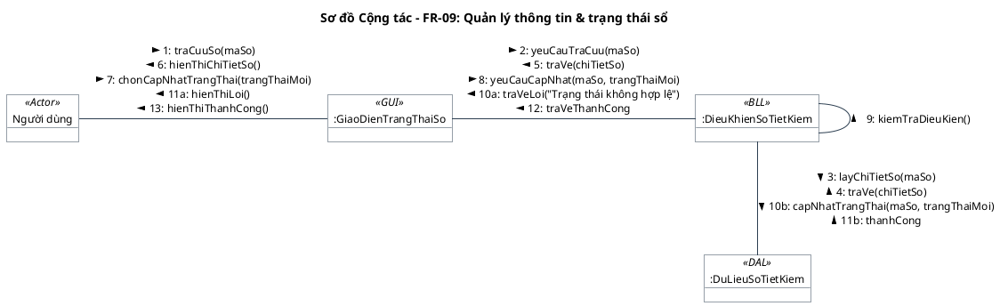

## 3.10. FR-10: Cung cấp báo cáo & thống kê

**Danh sách Đối tượng Tham gia:**

| Tầng | Tên Đối tượng trong Sơ đồ | Lớp (Class) tương ứng | Vai trò trong Use Case FR-10 |
| :--- | :--- | :--- | :--- |
| **Actor** | `Quản lý` | Quản lý / Kiểm soát viên | Tác nhân chọn loại báo cáo, khoảng thời gian và xuất thống kê. |
| **GUI** | `:GiaoDienBaoCao` | `GiaoDienBaoCao` (Boundary) | Tiếp nhận bộ lọc, hiển thị bảng biểu, đồ thị hoặc thông báo rỗng/lỗi. |
| **BLL** | `:DieuKhienBaoCao` | `DieuKhienBaoCao` (Control) | Kiểm tra tiêu chí thời gian và định dạng số liệu thống kê. |
| **DAL** | `:DuLieuHeThong` | `BaoCaoDAO` / `DuLieuHeThong` | Tổng hợp dữ liệu từ `GIAO_DICH_TIET_KIEM`, `SO_TIET_KIEM`, `CHU_KY_SO_TIET_KIEM`. |

**Bảng Truy vết Luồng Thông điệp (`docs/Sequence/FR 10.png`):**

| Thứ tự | Đối tượng gửi $\rightarrow$ Đối tượng nhận | Tên thông điệp / Phương thức | Ý nghĩa nghiệp vụ |
| :---: | :--- | :--- | :--- |
| **1** | `Quản lý` $\rightarrow$ `:GiaoDienBaoCao` | `chonTieuChi(loaiBaoCao, thoiGian)` | Quản lý chọn loại báo cáo và khoảng thời gian. |
| **2** | `:GiaoDienBaoCao` $\rightarrow$ `:DieuKhienBaoCao` | `yeuCauXuatBaoCao(loaiBaoCao, thoiGian)` | GUI gửi yêu cầu xuất báo cáo sang BLL. |
| **3** | `:DieuKhienBaoCao` $\rightarrow$ `:DieuKhienBaoCao` | `kiemTraTieuChi()` | BLL kiểm tra ngày kết thúc $\ge$ ngày bắt đầu. |
| **4a** | `:DieuKhienBaoCao` $\rightarrow$ `:GiaoDienBaoCao` | `traVeLoi("Thời gian sai")` | *[Tiêu chí không hợp lệ]* BLL trả lỗi thời gian. |
| **5a** | `:GiaoDienBaoCao` $\rightarrow$ `Quản lý` | `hienThiLoi()` | GUI hiển thị lỗi thời gian. |
| **4b** | `:DieuKhienBaoCao` $\rightarrow$ `:DuLieuHeThong` | `tongHopDuLieu(loaiBaoCao, thoiGian)` | *[Tiêu chí hợp lệ]* BLL yêu cầu DAL tổng hợp số liệu. |
| **5b** | `:DuLieuHeThong` $\rightarrow$ `:DieuKhienBaoCao` | `traVe(duLieuThongKe)` | DAL trả về kết quả truy xuất dữ liệu. |
| **6b1** | `:DieuKhienBaoCao` $\rightarrow$ `:GiaoDienBaoCao` | `traVeLoi("Không có phát sinh")` | *[Không có dữ liệu]* BLL thông báo không có dữ liệu trong kỳ. |
| **7b1** | `:GiaoDienBaoCao` $\rightarrow$ `Quản lý` | `hienThiThongBao()` | GUI hiển thị thông báo rỗng. |
| **6b2** | `:DieuKhienBaoCao` $\rightarrow$ `:DieuKhienBaoCao` | `formatTrinhBayBaoCao()` | *[Có dữ liệu]* BLL kết xuất dữ liệu thành bảng biểu và đồ thị. |
| **7b2** | `:DieuKhienBaoCao` $\rightarrow$ `:GiaoDienBaoCao` | `traVe(bangBieu, doThi)` | BLL trả dữ liệu báo cáo về GUI. |
| **8b2** | `:GiaoDienBaoCao` $\rightarrow$ `Quản lý` | `hienThiBaoCaoThongKe()` | GUI hiển thị báo cáo và hỗ trợ xuất file. |

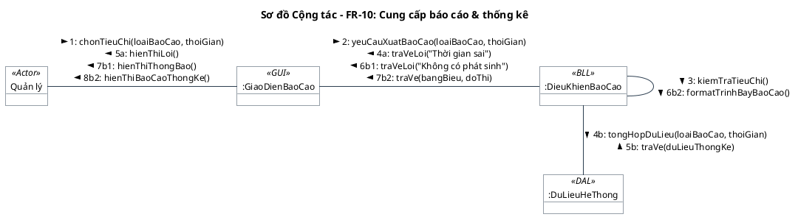

## 3.11. FR-11: Quản lý tài khoản & phân quyền

**Danh sách Đối tượng Tham gia:**

| Tầng | Tên Đối tượng trong Sơ đồ | Lớp (Class) tương ứng | Vai trò trong Use Case FR-11 |
| :--- | :--- | :--- | :--- |
| **Actor** | `Quản lý` | Quản lý / Quản trị viên | Tác nhân xem danh sách, tạo tài khoản, phân quyền hoặc đổi trạng thái. |
| **GUI** | `:GiaoDienQuanLyTaiKhoan` | `GiaoDienQuanLyTaiKhoan` (Boundary) | Hiển thị danh sách tài khoản và gửi lệnh cập nhật / phân quyền. |
| **BLL** | `:DieuKhienQuanTri` | `DieuKhienQuanTri` (Control) | Điều phối lấy danh sách và kiểm tra logic quyền hạn khi cập nhật. |
| **DAL** | `:DuLieuTaiKhoan` | `TaiKhoanDAO` / `DuLieuTaiKhoan` | Truy vấn và cập nhật `TAI_KHOAN_DANG_NHAP`, `TAI_KHOAN_VAI_TRO`, `VAI_TRO`, `QUYEN_TRUY_CAP`. |

**Bảng Truy vết Luồng Thông điệp (`docs/Sequence/FR 11.png`):**

| Thứ tự | Đối tượng gửi $\rightarrow$ Đối tượng nhận | Tên thông điệp / Phương thức | Ý nghĩa nghiệp vụ |
| :---: | :--- | :--- | :--- |
| **1** | `Quản lý` $\rightarrow$ `:GiaoDienQuanLyTaiKhoan` | `truyCapTrangQuanLy()` | Quản lý mở trang quản lý tài khoản & phân quyền. |
| **2** | `:GiaoDienQuanLyTaiKhoan` $\rightarrow$ `:DieuKhienQuanTri` | `yeuCauLayDanhSachTaiKhoan()` | GUI yêu cầu BLL lấy danh sách tài khoản. |
| **3** | `:DieuKhienQuanTri` $\rightarrow$ `:DuLieuTaiKhoan` | `truyVanTatCaTaiKhoan()` | BLL yêu cầu DAL đọc toàn bộ tài khoản. |
| **4** | `:DuLieuTaiKhoan` $\rightarrow$ `:DieuKhienQuanTri` | `traVe(danhSachTaiKhoan)` | DAL trả về danh sách tài khoản. |
| **5** | `:DieuKhienQuanTri` $\rightarrow$ `:GiaoDienQuanLyTaiKhoan` | `traVe(danhSachTaiKhoan)` | BLL chuyển danh sách về GUI. |
| **6** | `:GiaoDienQuanLyTaiKhoan` $\rightarrow$ `Quản lý` | `hienThiDanhSach(danhSachTaiKhoan)` | GUI hiển thị danh sách tài khoản. |
| **7** | `Quản lý` $\rightarrow$ `:GiaoDienQuanLyTaiKhoan` | `chonCapNhat(maTaiKhoan, hanhDong)` | Quản lý chọn tạo / phân quyền / đổi trạng thái. |
| **8** | `:GiaoDienQuanLyTaiKhoan` $\rightarrow$ `:DieuKhienQuanTri` | `thucHienCapNhat(maTaiKhoan, hanhDong)` | GUI gửi yêu cầu cập nhật sang BLL. |
| **9** | `:DieuKhienQuanTri` $\rightarrow$ `:DuLieuTaiKhoan` | `capNhatTrangThai(maTaiKhoan, hanhDong)` | BLL gọi DAL lưu trạng thái / vai trò mới. |
| **10** | `:DuLieuTaiKhoan` $\rightarrow$ `:DieuKhienQuanTri` | `thanhCong` | DAL xác nhận cập nhật thành công. |
| **11** | `:DieuKhienQuanTri` $\rightarrow$ `:GiaoDienQuanLyTaiKhoan` | `traVeThanhCong` | BLL báo hoàn tất cho GUI. |
| **12** | `:GiaoDienQuanLyTaiKhoan` $\rightarrow$ `Quản lý` | `hienThiThanhCong()` | GUI thông báo cập nhật thành công. |

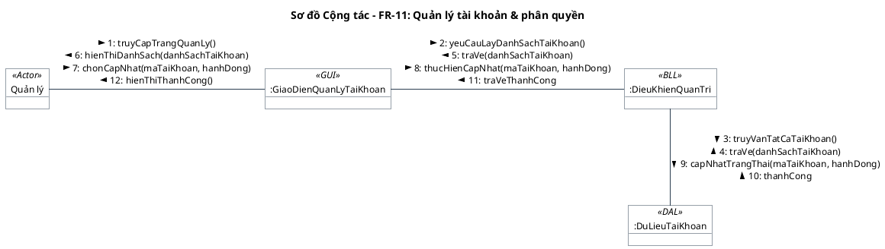

## 3.12. FR-12: Quản lý danh mục & lãi suất

**Danh sách Đối tượng Tham gia:**

| Tầng | Tên Đối tượng trong Sơ đồ | Lớp (Class) tương ứng | Vai trò trong Use Case FR-12 |
| :--- | :--- | :--- | :--- |
| **Actor** | `Quản lý` | Quản lý / Quản trị viên | Tác nhân xem danh mục sản phẩm và cấu hình kỳ hạn / lãi suất mới. |
| **GUI** | `:GiaoDienLaiSuat` | `GiaoDienLaiSuat` (Boundary) | Hiển thị biểu lãi suất hiện hành và tiếp nhận tham số cấu hình mới. |
| **BLL** | `:DieuKhienLaiSuat` | `DieuKhienLaiSuat` (Control) | Kiểm tra logic giá trị lãi suất (`> 0`) và kỳ hạn trước khi lưu. |
| **DAL** | `:DuLieuLaiSuat` | `BieuLaiSuatDAO` / `DuLieuLaiSuat` | Truy xuất và cập nhật `SAN_PHAM_TIET_KIEM`, `KY_HAN_TIET_KIEM`, `BIEU_LAI_SUAT`. |

**Bảng Truy vết Luồng Thông điệp (`docs/Sequence/FR 12.png`):**

| Thứ tự | Đối tượng gửi $\rightarrow$ Đối tượng nhận | Tên thông điệp / Phương thức | Ý nghĩa nghiệp vụ |
| :---: | :--- | :--- | :--- |
| **1** | `Quản lý` $\rightarrow$ `:GiaoDienLaiSuat` | `truyCapDanhMuc()` | Mở trang quản lý danh mục & biểu lãi suất. |
| **2** | `:GiaoDienLaiSuat` $\rightarrow$ `:DieuKhienLaiSuat` | `yeuCauLayDanhSach()` | GUI yêu cầu BLL lấy danh sách biểu lãi suất. |
| **3** | `:DieuKhienLaiSuat` $\rightarrow$ `:DuLieuLaiSuat` | `truyVanTatCa()` | BLL gọi DAL truy vấn tất cả cấu hình hiện tại. |
| **4** | `:DuLieuLaiSuat` $\rightarrow$ `:DieuKhienLaiSuat` | `traVe(danhSachLaiSuat)` | DAL trả về danh sách biểu lãi suất. |
| **5** | `:DieuKhienLaiSuat` $\rightarrow$ `:GiaoDienLaiSuat` | `traVe(danhSachLaiSuat)` | BLL chuyển danh sách về GUI. |
| **6** | `:GiaoDienLaiSuat` $\rightarrow$ `Quản lý` | `hienThiDanhSach()` | GUI hiển thị bảng lãi suất hiện tại. |
| **7** | `Quản lý` $\rightarrow$ `:GiaoDienLaiSuat` | `nhapThamSoMoi(kyHan, laiSuatMoi)` | Nhập kỳ hạn mới hoặc điều chỉnh mức lãi suất. |
| **8** | `:GiaoDienLaiSuat` $\rightarrow$ `:DieuKhienLaiSuat` | `yeuCauCapNhat(kyHan, laiSuatMoi)` | GUI gửi tham số cấu hình mới sang BLL. |
| **9** | `:DieuKhienLaiSuat` $\rightarrow$ `:DieuKhienLaiSuat` | `kiemTraLogic(laiSuatMoi > 0)` | BLL kiểm tra điều kiện lãi suất dương và không trùng kỳ hạn. |
| **10a** | `:DieuKhienLaiSuat` $\rightarrow$ `:GiaoDienLaiSuat` | `traVeLoi("Lỗi giá trị")` | *[Tham số không hợp lệ]* BLL trả lỗi giá trị. |
| **11a** | `:GiaoDienLaiSuat` $\rightarrow$ `Quản lý` | `hienThiLoi()` | GUI thông báo lỗi giá trị không hợp lệ. |
| **10b** | `:DieuKhienLaiSuat` $\rightarrow$ `:DuLieuLaiSuat` | `capNhatThamSo(kyHan, laiSuatMoi)` | *[Hợp lệ]* BLL gọi DAL lưu cấu hình lãi suất mới. |
| **11b** | `:DuLieuLaiSuat` $\rightarrow$ `:DieuKhienLaiSuat` | `thanhCong` | DAL xác nhận đã lưu cấu hình. |
| **12** | `:DieuKhienLaiSuat` $\rightarrow$ `:GiaoDienLaiSuat` | `traVeThanhCong` | BLL báo hoàn tất về GUI. |
| **13** | `:GiaoDienLaiSuat` $\rightarrow$ `Quản lý` | `hienThiThanhCong()` | GUI xác nhận cấu hình đã được lưu thành công. |

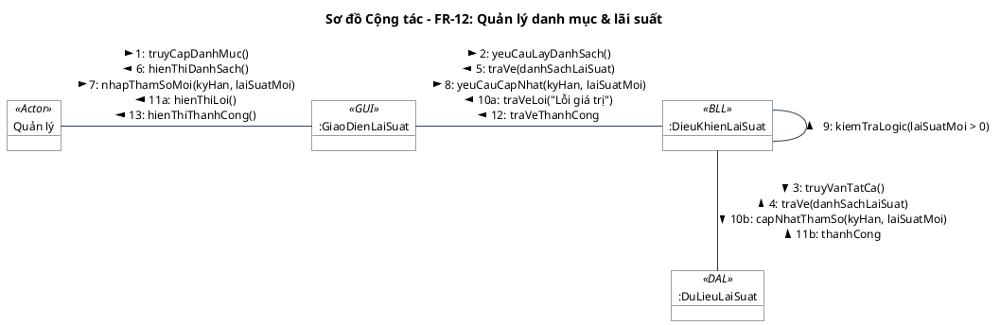

## 3.13. FR-13: Gửi thông báo đáo hạn

**Danh sách Đối tượng Tham gia:**

| Tầng | Tên Đối tượng trong Sơ đồ | Lớp (Class) tương ứng | Vai trò trong Use Case FR-13 |
| :--- | :--- | :--- | :--- |
| **Actor** | `Hệ thống tự động` | Tiến trình Timer / Scheduler | Tác nhân tự động kích hoạt quét định kỳ cuối ngày. |
| **BLL** | `:DieuKhienDaoHan` | `DieuKhienDaoHan` (Control) | Lọc danh sách sổ sắp đáo hạn, tạo nội dung và xử lý thử lại khi lỗi. |
| **DAL** | `:DuLieuSoTietKiem` | `SoTietKiemDAO` / `DuLieuSoTietKiem` | Đọc sổ sắp đáo hạn và cập nhật bảng `THONG_BAO` (`SO_TIET_KIEM`, `CHU_KY_SO_TIET_KIEM`). |
| **Boundary** | `:DichVuGuiTinNhan` | `DichVuGuiTinNhan` (External Gateway) | Cổng giao tiếp gửi tin nhắn qua Web / Email / SMS. |

**Bảng Truy vết Luồng Thông điệp (`docs/Sequence/FR 13.png`):**

| Thứ tự | Đối tượng gửi $\rightarrow$ Đối tượng nhận | Tên thông điệp / Phương thức | Ý nghĩa nghiệp vụ |
| :---: | :--- | :--- | :--- |
| **1** | `Hệ thống tự động` $\rightarrow$ `:DieuKhienDaoHan` | `kichHoatQuetDinhKy()` | Bộ định thời kích hoạt tiến trình quét cuối ngày. |
| **2** | `:DieuKhienDaoHan` $\rightarrow$ `:DuLieuSoTietKiem` | `locSoSapDaoHan(1 den 3 ngay)` | BLL yêu cầu DAL lọc các sổ đang hoạt động sắp đáo hạn. |
| **3** | `:DuLieuSoTietKiem` $\rightarrow$ `:DieuKhienDaoHan` | `traVe(danhSachSo)` | DAL trả về danh sách sổ sắp đáo hạn. |
| **4a** | `:DieuKhienDaoHan` $\rightarrow$ `:DieuKhienDaoHan` | `ketThucTienTrinh()` | *[danhSachSo rỗng]* Kết thúc sớm tiến trình. |
| **4b** | `:DieuKhienDaoHan` $\rightarrow$ `:DieuKhienDaoHan` | `taoNoiDungThongBao(thongTinSo)` | *[Loop từng sổ]* Tạo nội dung thông báo nhắc đáo hạn. |
| **5** | `:DieuKhienDaoHan` $\rightarrow$ `:DichVuGuiTinNhan` | `guiTinNhan(sdt, noiDung)` | Gửi thông báo qua cổng viễn thông / Email / App. |
| **6a** | `:DichVuGuiTinNhan` $\rightarrow$ `:DieuKhienDaoHan` | `traVeLoi(Timeout)` | *[Gửi lỗi]* Cổng dịch vụ phản hồi lỗi kết nối. |
| **7a** | `:DieuKhienDaoHan` $\rightarrow$ `:DieuKhienDaoHan` | `ghiLogThuLai()` | Ghi log lỗi và đánh dấu thử lại ở chu kỳ sau. |
| **6b** | `:DichVuGuiTinNhan` $\rightarrow$ `:DieuKhienDaoHan` | `thanhCong` | *[Gửi thành công]* Xác nhận gửi tin thành công. |
| **7b** | `:DieuKhienDaoHan` $\rightarrow$ `:DuLieuSoTietKiem` | `capNhatTrangThaiDaGui()` | BLL yêu cầu DAL cập nhật trạng thái đã thông báo. |
| **8b** | `:DuLieuSoTietKiem` $\rightarrow$ `:DieuKhienDaoHan` | `thanhCong` | DAL xác nhận cập nhật trạng thái. |

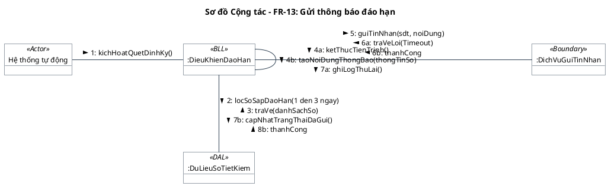

## 3.14. FR-14: Xử lý tái tục sổ tự động

**Danh sách Đối tượng Tham gia:**

| Tầng | Tên Đối tượng trong Sơ đồ | Lớp (Class) tương ứng | Vai trò trong Use Case FR-14 |
| :--- | :--- | :--- | :--- |
| **Actor** | `Hệ thống tự động` | Tiến trình Timer / Scheduler | Tác nhân tự động kích hoạt xử lý tái tục cuối ngày. |
| **BLL** | `:DieuKhienTaiTuc` | `DieuKhienTaiTuc` (Control) | Kiểm tra trạng thái/chỉ thị tái tục, tính lãi thực tế và cộng gốc lãi sang kỳ mới. |
| **DAL** | `:DuLieuSoTietKiem` | `SoTietKiemDAO` / `DuLieuSoTietKiem` | Lọc sổ tới hạn hôm nay và cập nhật `CHU_KY_SO_TIET_KIEM`, `GIAO_DICH_TIET_KIEM`. |

**Bảng Truy vết Luồng Thông điệp (`docs/Sequence/FR 14.png`):**

| Thứ tự | Đối tượng gửi $\rightarrow$ Đối tượng nhận | Tên thông điệp / Phương thức | Ý nghĩa nghiệp vụ |
| :---: | :--- | :--- | :--- |
| **1** | `Hệ thống tự động` $\rightarrow$ `:DieuKhienTaiTuc` | `kichHoatXuLyCuoiNgay()` | Kích hoạt tiến trình tái tục sổ cuối ngày. |
| **2** | `:DieuKhienTaiTuc` $\rightarrow$ `:DuLieuSoTietKiem` | `locSoToiHanHomNay()` | BLL yêu cầu DAL lấy danh sách sổ đến ngày đáo hạn. |
| **3** | `:DuLieuSoTietKiem` $\rightarrow$ `:DieuKhienTaiTuc` | `traVe(danhSachSoToiHan)` | DAL trả về danh sách sổ tới hạn. |
| **4** | `:DieuKhienTaiTuc` $\rightarrow$ `:DieuKhienTaiTuc` | `kiemTraTrangThaiSo()` | *[Loop từng sổ]* Kiểm tra trạng thái và chỉ thị đáo hạn. |
| **5a** | `:DieuKhienTaiTuc` $\rightarrow$ `:DieuKhienTaiTuc` | `boQuaVaGhiLog(ChoXuLyThuCong)` | *[Bị phong tỏa / không tự động]* Bỏ qua và ghi log chờ xử lý thủ công. |
| **5b** | `:DieuKhienTaiTuc` $\rightarrow$ `:DieuKhienTaiTuc` | `tinhLaiThucTe()` | *[Hợp lệ]* Tính tiền lãi thực tế của kỳ hạn vừa kết thúc. |
| **6b** | `:DieuKhienTaiTuc` $\rightarrow$ `:DieuKhienTaiTuc` | `congGocVaLaiPhanKyMoi()` | Cộng dồn gốc + lãi sang chu kỳ mới. |
| **7b** | `:DieuKhienTaiTuc` $\rightarrow$ `:DuLieuSoTietKiem` | `capNhatNgayDaoHanMoi(soTienMoi, ngayMoi)` | BLL gọi DAL lưu chu kỳ mới, số dư mới và ngày đáo hạn mới. |
| **8b** | `:DuLieuSoTietKiem` $\rightarrow$ `:DieuKhienTaiTuc` | `thanhCong` | DAL xác nhận cập nhật thành công. |

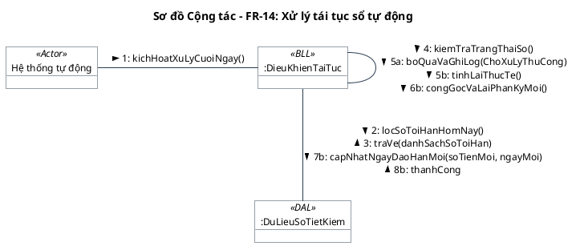

## 3.15. EX-01: Sai mật khẩu / Giải quyết PIN

**Danh sách Đối tượng Tham gia:**

| Tầng | Tên Đối tượng trong Sơ đồ | Lớp (Class) tương ứng | Vai trò trong Use Case EX-01 |
| :--- | :--- | :--- | :--- |
| **Actor** | `Người dùng` | Khách hàng / Nhân viên / Quản lý | Tác nhân nhập sai thông tin đăng nhập (Extend từ `FR-01`). |
| **GUI** | `:GiaoDienDangNhap` | `GiaoDienDangNhap` (Boundary) | Hiển thị thông báo sai mật khẩu hoặc cảnh báo khóa tài khoản. |
| **BLL** | `:DieuKhienDangNhap` | `DieuKhienDangNhap` (Control) | Đối chiếu mật khẩu, tăng bộ đếm sai và kích hoạt khóa tạm thời khi sai $\ge$ 5 lần. |
| **DAL** | `:DuLieuTaiKhoan` | `TaiKhoanDAO` / `DuLieuTaiKhoan` | Cập nhật `so_lan_dang_nhap_sai`, `trang_thai`, `khoa_den` trên `TAI_KHOAN_DANG_NHAP`. |

**Bảng Truy vết Luồng Thông điệp (`docs/Sequence/EX 01.png`):**

| Thứ tự | Đối tượng gửi $\rightarrow$ Đối tượng nhận | Tên thông điệp / Phương thức | Ý nghĩa nghiệp vụ |
| :---: | :--- | :--- | :--- |
| **1** | `Người dùng` $\rightarrow$ `:GiaoDienDangNhap` | `nhapThongTin(tenDangNhap, matKhau)` | Người dùng nhập thông tin đăng nhập. |
| **2** | `:GiaoDienDangNhap` $\rightarrow$ `:DieuKhienDangNhap` | `yeuCauXacThuc(tenDangNhap, matKhau)` | GUI gửi yêu cầu xác thực sang BLL. |
| **3** | `:DieuKhienDangNhap` $\rightarrow$ `:DuLieuTaiKhoan` | `layThongTinTaiKhoan(tenDangNhap)` | BLL gọi DAL lấy thông tin tài khoản. |
| **4** | `:DuLieuTaiKhoan` $\rightarrow$ `:DieuKhienDangNhap` | `traVe(thongTinTaiKhoan)` | DAL trả về thông tin tài khoản. |
| **5** | `:DieuKhienDangNhap` $\rightarrow$ `:DieuKhienDangNhap` | `soSanhMatKhau()` | BLL kiểm tra mật khẩu (phát hiện không khớp). |
| **6** | `:DieuKhienDangNhap` $\rightarrow$ `:DuLieuTaiKhoan` | `tangSoLanNhapSai(tenDangNhap)` | BLL yêu cầu DAL tăng biến đếm sai thêm 1. |
| **7** | `:DuLieuTaiKhoan` $\rightarrow$ `:DieuKhienDangNhap` | `traVe(soLanNhapSai)` | DAL trả về tổng số lần nhập sai hiện tại. |
| **8a** | `:DieuKhienDangNhap` $\rightarrow$ `:DuLieuTaiKhoan` | `khoaTaiKhoan(tenDangNhap)` | *[soLanNhapSai >= 5]* BLL yêu cầu DAL khóa tạm thời tài khoản. |
| **9a** | `:DuLieuTaiKhoan` $\rightarrow$ `:DieuKhienDangNhap` | `thanhCong` | DAL xác nhận đã khóa tài khoản. |
| **10a** | `:DieuKhienDangNhap` $\rightarrow$ `:GiaoDienDangNhap` | `traVeLoi("Tài khoản bị khóa")` | BLL trả thông báo khóa tài khoản cho GUI. |
| **11a** | `:GiaoDienDangNhap` $\rightarrow$ `Người dùng` | `hienThiCanhBaoKhoa()` | GUI hiển thị cảnh báo tài khoản đã bị khóa. |
| **8b** | `:DieuKhienDangNhap` $\rightarrow$ `:GiaoDienDangNhap` | `traVeLoi("Sai mật khẩu")` | *[soLanNhapSai < 5]* BLL trả lỗi sai mật khẩu. |
| **9b** | `:GiaoDienDangNhap` $\rightarrow$ `Người dùng` | `hienThiLoiVaYeuCauNhapLai()` | GUI thông báo sai mật khẩu và gợi ý nhập lại / khôi phục. |

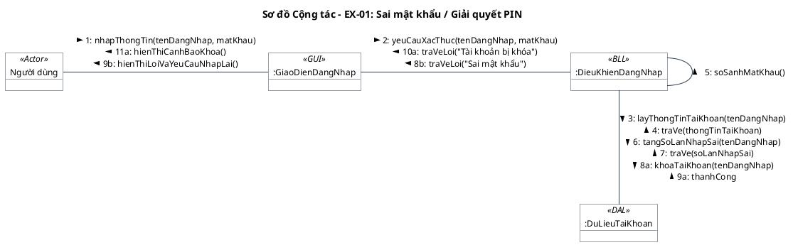

## 3.16. EX-02: Gửi thông báo Email/SMS

**Danh sách Đối tượng Tham gia:**

| Tầng | Tên Đối tượng trong Sơ đồ | Lớp (Class) tương ứng | Vai trò trong Use Case EX-02 |
| :--- | :--- | :--- | :--- |
| **Boundary / Caller** | `:GiaoDien / HeThong` | Luồng gọi từ `FR-03` | Hệ thống gọi kích hoạt gửi tin xác nhận sau khi mở sổ thành công. |
| **BLL** | `:DieuKhienThongBao` | `DieuKhienThongBao` (Control) | Tạo nội dung tin nhắn từ mẫu và xử lý hàng đợi thử lại khi lỗi mạng. |
| **DAL** | `:DuLieuSoTietKiem` | `SoTietKiemDAO` / `DuLieuSoTietKiem` | Trích xuất chi tiết sổ (`SO_TIET_KIEM`) và SĐT/Email khách (`NGUOI_DUNG`), lưu `THONG_BAO`. |
| **Boundary** | `:DichVuGuiTinNhan` | `DichVuGuiTinNhan` (External API) | API dịch vụ viễn thông / SMTP bên thứ 3 thực hiện gửi SMS/Email. |

**Bảng Truy vết Luồng Thông điệp (`docs/Sequence/EX 02.png`):**

| Thứ tự | Đối tượng gửi $\rightarrow$ Đối tượng nhận | Tên thông điệp / Phương thức | Ý nghĩa nghiệp vụ |
| :---: | :--- | :--- | :--- |
| **1** | `:GiaoDien / HeThong` $\rightarrow$ `:DieuKhienThongBao` | `yeuCauGuiXacNhan(maSo)` | Kích hoạt luồng gửi thông báo xác nhận mã sổ mới. |
| **2** | `:DieuKhienThongBao` $\rightarrow$ `:DuLieuSoTietKiem` | `layThongTinChiTiet(maSo)` | BLL gọi DAL lấy thông tin sổ và số điện thoại/email khách. |
| **3** | `:DuLieuSoTietKiem` $\rightarrow$ `:DieuKhienThongBao` | `traVe(thongTinSo, sdt)` | DAL trả về dữ liệu sổ và liên hệ khách hàng. |
| **4** | `:DieuKhienThongBao` $\rightarrow$ `:DieuKhienThongBao` | `taoNoiDungSMS(thongTinSo)` | BLL soạn thảo nội dung tin nhắn theo template chuẩn. |
| **5** | `:DieuKhienThongBao` $\rightarrow$ `:DichVuGuiTinNhan` | `goiAPIGuiTin(sdt, noiDung)` | BLL gọi API bên thứ 3 gửi tin đi. |
| **6a** | `:DichVuGuiTinNhan` $\rightarrow$ `:DieuKhienThongBao` | `traVeLoi(LoiMang)` | *[Gửi thất bại]* Cổng API trả về lỗi mạng. |
| **7a** | `:DieuKhienThongBao` $\rightarrow$ `:DieuKhienThongBao` | `ghiVaoHangDoiThuLai()` | Ghi log sự cố và đưa tin nhắn vào hàng đợi thử lại sau. |
| **6b** | `:DichVuGuiTinNhan` $\rightarrow$ `:DieuKhienThongBao` | `thanhCong` | *[Gửi thành công]* API xác nhận đã gửi tin thành công. |
| **8** | `:DieuKhienThongBao` $\rightarrow$ `:GiaoDien / HeThong` | `ketThucXuLy()` | BLL trả kết quả hoàn tất quy trình gửi thông báo. |

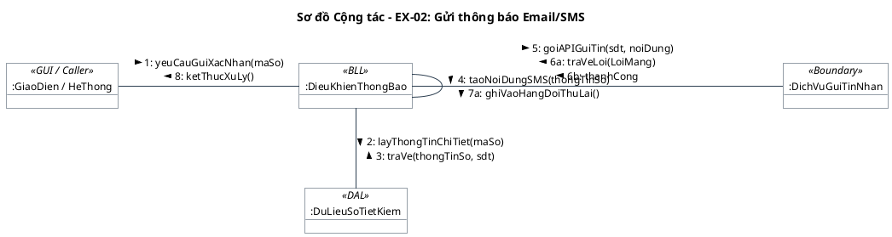

## 3.17. EX-03: Tất toán trước hạn

**Danh sách Đối tượng Tham gia:**

| Tầng | Tên Đối tượng trong Sơ đồ | Lớp (Class) tương ứng | Vai trò trong Use Case EX-03 |
| :--- | :--- | :--- | :--- |
| **Actor** | `Người dùng` | Khách hàng / Nhân viên giao dịch | Tác nhân xem cảnh báo mất lãi và quyết định đồng ý hoặc hủy rút trước hạn. |
| **GUI** | `:GiaoDienTatToan` | `GiaoDienTatToan` (Boundary) | Hiển thị cảnh báo lãi không kỳ hạn và tiếp nhận nút bấm xác nhận / hủy. |
| **BLL** | `:DieuKhienTatToan` | `DieuKhienTatToan` (Control) | Hủy lãi kỳ hạn, tính lãi không kỳ hạn theo ngày thực gửi và điều hướng kết quả. |

**Bảng Truy vết Luồng Thông điệp (`docs/Sequence/EX 03.png`):**

| Thứ tự | Đối tượng gửi $\rightarrow$ Đối tượng nhận | Tên thông điệp / Phương thức | Ý nghĩa nghiệp vụ |
| :---: | :--- | :--- | :--- |
| **1** | `:DieuKhienTatToan` $\rightarrow$ `:DieuKhienTatToan` | `huyLaiSuatKyHan()` | BLL hủy bỏ áp dụng lãi suất có kỳ hạn (Extend từ `FR-07`). |
| **2** | `:DieuKhienTatToan` $\rightarrow$ `:DieuKhienTatToan` | `tinhLaiKhongKyHan(soNgayThucGui)` | Tính toán lại tiền lãi theo lãi suất không kỳ hạn hiện hành. |
| **3** | `:DieuKhienTatToan` $\rightarrow$ `:GiaoDienTatToan` | `canhBaoMatLai(goc, laiMoi)` | Gửi số tiền thực nhận mới kèm cảnh báo mất lãi lên GUI. |
| **4** | `:GiaoDienTatToan` $\rightarrow$ `Người dùng` | `yeuCauXacNhan(goc, laiMoi)` | GUI hiển thị cảnh báo và yêu cầu khách xác nhận rút trước hạn. |
| **5a** | `Người dùng` $\rightarrow$ `:GiaoDienTatToan` | `chonHuyTatToan()` | *[Hủy giao dịch]* Người dùng bấm hủy tất toán. |
| **6a** | `:GiaoDienTatToan` $\rightarrow$ `:DieuKhienTatToan` | `huyYeuCau()` | GUI gửi lệnh hủy yêu cầu tất toán sang BLL. |
| **7a** | `:DieuKhienTatToan` $\rightarrow$ `:GiaoDienTatToan` | `ketThucGiaoDich` | BLL kết thúc giao dịch và trả cờ hủy. |
| **8a** | `:GiaoDienTatToan` $\rightarrow$ `Người dùng` | `quayLaiTrangChu()` | GUI điều hướng người dùng quay lại trang chủ. |
| **5b** | `Người dùng` $\rightarrow$ `:GiaoDienTatToan` | `xacNhanDongY()` | *[Đồng ý rút trước hạn]* Người dùng bấm đồng ý rút. |
| **6b** | `:GiaoDienTatToan` $\rightarrow$ `:DieuKhienTatToan` | `tiepTucTatToan()` | GUI gửi lệnh tiếp tục luồng tất toán chính (`FR-07`). |

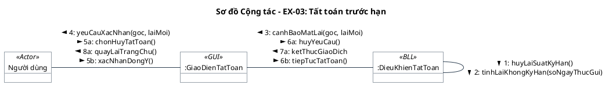

---

# PHẦN 4: SƠ ĐỒ HOẠT ĐỘNG MỨC THIẾT KẾ (Design-level Activity Diagrams — 17 Use Case)

> **Nguyên tắc đồng nhất:** Phân 3 làn theo tầng logic (`GUI` / `Boundary`, `BLL`, `DAL`), nhánh lỗi rẽ gọn lên giao diện và kết thúc (`stop`), loại bỏ hoàn toàn tình trạng nhảy làn chéo gây đè đường nối.

## 4.1. FR-01: Đăng nhập & Xác thực

**Bảng Truy vết 3 Tầng (Use Case FR-01):**

| Bước nghiệp vụ | Xử lý tại Tầng GUI | Xử lý tại Tầng BLL | Xử lý tại Tầng DAL / CSDL |
| :--- | :--- | :--- | :--- |
| **1. Nhập thông tin đăng nhập** | `GiaoDienDangNhap` kiểm tra tên đăng nhập, mật khẩu không rỗng và gửi yêu cầu. | `DieuKhienDangNhap` tiếp nhận thông tin xác thực. | `DuLieuTaiKhoan` truy vấn bảng `TAI_KHOAN_DANG_NHAP`. |
| **2. Kiểm tra mật khẩu & trạng thái** | Hiển thị thông báo lỗi hoặc cảnh báo khóa nếu sai/bị khóa. | Kiểm tra khớp mật khẩu băm (nếu sai gọi `UC-EX01`); kiểm tra `trang_thai == "Hoạt động"`. | Đọc `mat_khau_bam`, `trang_thai`, `khoa_den`. |
| **3. Khởi tạo phiên & phân quyền** | Điều hướng sang trang chủ tương ứng vai trò (`KHACH_HANG`, `GIAO_DICH_VIEN`, `KIEM_SOAT_VIEN`, `ADMIN`). | Khởi tạo phiên làm việc và xác định danh sách quyền từ vai trò. | Truy xuất `TAI_KHOAN_VAI_TRO`, `VAI_TRO`, cập nhật `dang_nhap_cuoi`. |

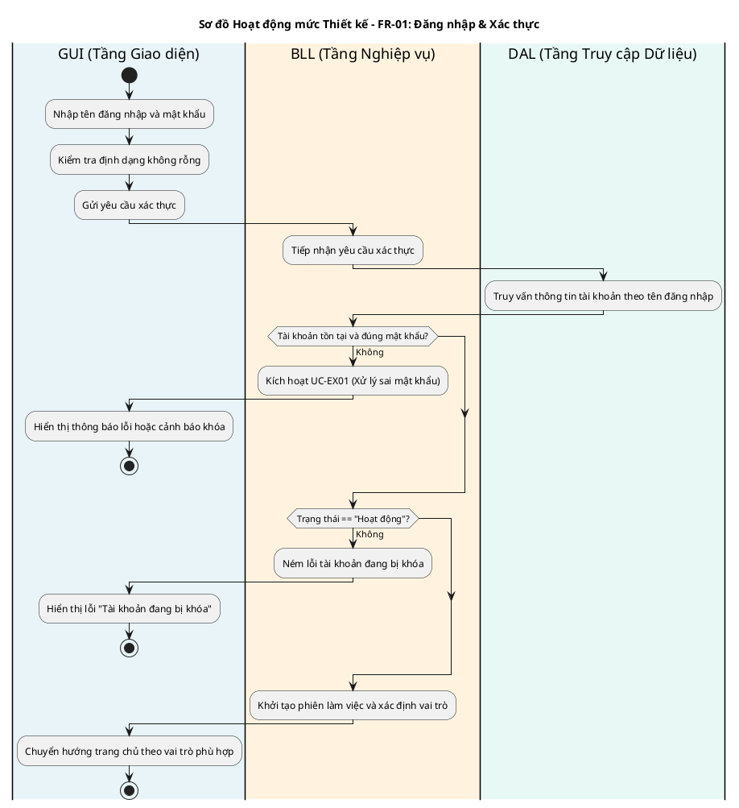

## 4.2. FR-02: Quản lý thông tin cá nhân

**Bảng Truy vết 3 Tầng (Use Case FR-02):**

| Bước nghiệp vụ | Xử lý tại Tầng GUI | Xử lý tại Tầng BLL | Xử lý tại Tầng DAL / CSDL |
| :--- | :--- | :--- | :--- |
| **1. Tải hồ sơ hiện tại** | `GiaoDienThongTinCaNhan` hiển thị thông tin người dùng hiện tại. | `DieuKhienNguoiDung` tiếp nhận `maNguoiDung` và gọi DAL. | `DuLieuHoSo` đọc từ `NGUOI_DUNG`, `HO_SO_KHACH_HANG`. |
| **2. Chỉnh sửa & kiểm tra dữ liệu** | Nhập thông tin sửa đổi (Email, SĐT, CCCD, địa chỉ) và nhấn `"Lưu"`; hiển thị lỗi nếu sai định dạng. | Kiểm tra định dạng Email, SĐT, CCCD hợp lệ; trả lỗi nếu vi phạm. | — |
| **3. Lưu thông tin cập nhật** | Hiển thị thông báo cập nhật hồ sơ thành công. | Điều phối lệnh lưu hồ sơ. | Cập nhật `NGUOI_DUNG`, `HO_SO_KHACH_HANG` (`ngay_cap_nhat`). |

```plantuml
@startuml Activity_FR02
title Sơ đồ Hoạt động mức Thiết kế - FR-02: Quản lý thông tin cá nhân

|#E8F4F8|GUI (Tầng Giao diện)|
start
:Chọn chức năng xem thông tin cá nhân;

|#FFF3E0|BLL (Tầng Nghiệp vụ)|
:Yêu cầu lấy hồ sơ người dùng;

|#E8F8F5|DAL (Tầng Truy cập Dữ liệu)|
:Truy vấn thông tin hồ sơ từ CSDL;

|GUI (Tầng Giao diện)|
:Tải và hiển thị hồ sơ hiện tại;
:Chỉnh sửa thông tin và nhấn "Lưu";

|BLL (Tầng Nghiệp vụ)|
:Kiểm tra tính hợp lệ (Email / SĐT / CCCD);
if (Định dạng dữ liệu hợp lệ?) then (Không)
  :Trả về lỗi định dạng;
  |GUI (Tầng Giao diện)|
  :Hiển thị thông báo lỗi định dạng dữ liệu;
  stop
endif

|DAL (Tầng Truy cập Dữ liệu)|
:Lưu thông tin cá nhân cập nhật vào CSDL;

|GUI (Tầng Giao diện)|
:Hiển thị thông báo cập nhật thành công;
stop
@enduml
```

## 4.3. FR-03: Mở sổ tiết kiệm online

**Bảng Truy vết 3 Tầng (Use Case FR-03):**

| Bước nghiệp vụ | Xử lý tại Tầng GUI | Xử lý tại Tầng BLL | Xử lý tại Tầng DAL / CSDL |
| :--- | :--- | :--- | :--- |
| **1. Nhập thông tin & xác nhận** | `GiaoDienMoSoOnline` nhận sản phẩm, kỳ hạn, số tiền, phương thức tái tục; kiểm tra định dạng và ghi nhận bấm nút xác nhận. | — | — |
| **2. Kiểm tra điều kiện & số dư** | Gửi yêu cầu sang BLL; hiển thị lỗi nếu không đủ điều kiện và kết thúc. | `DieuKhienGiaoDich` kiểm tra số tiền $\ge$ mức tối thiểu và đối chiếu `soDu >= soTien`. | `DuLieuTaiKhoan` đọc `so_du` từ `TAI_KHOAN_THANH_TOAN` và mức tối thiểu từ `SAN_PHAM_TIET_KIEM`. |
| **3. Trừ tiền & tạo sổ (Transaction)** | Hiển thị thông báo mở sổ thành công kèm mã sổ mới. | Quản lý `BEGIN/COMMIT TRANSACTION`, gọi `UC-EX02` gửi thông báo. | • Trừ `so_du` ở `TAI_KHOAN_THANH_TOAN`.<br>• Ghi `SO_TIET_KIEM`, `CHU_KY_SO_TIET_KIEM` (chu kỳ 1), `GIAO_DICH_TIET_KIEM` (`MO_SO`). |

```plantuml
@startuml Activity_FR03
title Sơ đồ Hoạt động mức Thiết kế - FR-03: Mở sổ tiết kiệm online

|#E8F4F8|GUI (Tầng Giao diện)|
start
:Khách hàng chọn chức năng Mở sổ online;
:Nhập thông tin: sản phẩm, kỳ hạn, số tiền, phương thức tái tục;
:Kiểm tra định dạng dữ liệu đầu vào;
:Khách hàng bấm xác nhận giao dịch mở sổ;
:Gửi yêu cầu mở sổ sang hệ thống;

|#FFF3E0|BLL (Tầng Nghiệp vụ)|
:Tiếp nhận yêu cầu mở sổ;
:Kiểm tra quy định số tiền gửi tối thiểu;

|#E8F8F5|DAL (Tầng Truy cập Dữ liệu)|
:Truy vấn số dư tài khoản thanh toán và thông số sản phẩm;

|BLL (Tầng Nghiệp vụ)|
if (Số dư TK >= Số tiền gửi \nvà Số tiền gửi >= Mức tối thiểu?) then (Không đủ điều kiện)
  :Ném lỗi nghiệp vụ (Số dư không đủ hoặc sai hạn mức);
  |GUI (Tầng Giao diện)|
  :Hiển thị thông báo lỗi lên màn hình;
  stop
else (Đủ điều kiện)
  |BLL (Tầng Nghiệp vụ)|
  :Khởi tạo giao dịch an toàn (BEGIN TRANSACTION);

  |DAL (Tầng Truy cập Dữ liệu)|
  :Trừ số dư tài khoản thanh toán nguồn;
  :Thêm mới bản ghi Sổ tiết kiệm (Trạng thái 'DANG_HOAT_DONG');
  :Thêm mới Chu kỳ 1 và Giao dịch mở sổ (Bảng Sổ cái);

  |BLL (Tầng Nghiệp vụ)|
  :Cam kết ghi nhận toàn bộ dữ liệu (COMMIT TRANSACTION);
  :Kích hoạt dịch vụ gửi thông báo xác nhận (UC-EX02);

  |GUI (Tầng Giao diện)|
  :Hiển thị thông báo mở sổ thành công kèm mã sổ mới;
  stop
endif
@enduml
```

## 4.4. FR-04: Mở sổ tiết kiệm trực tiếp (tại quầy)

**Bảng Truy vết 3 Tầng (Use Case FR-04):**

| Bước nghiệp vụ | Xử lý tại Tầng GUI | Xử lý tại Tầng BLL | Xử lý tại Tầng DAL / CSDL |
| :--- | :--- | :--- | :--- |
| **1. Tìm kiếm hồ sơ khách (CCCD)** | `GiaoDienMoSoTaiQuay` nhập CCCD tìm khách; thông báo yêu cầu bổ sung nếu thiếu hồ sơ. | `DieuKhienGiaoDich` kiểm tra tính đầy đủ hồ sơ khách hàng. | `DuLieuKhachHang` truy vấn `KHACH_HANG`, `HO_SO_KHACH_HANG` theo `so_cccd`. |
| **2. Kiểm tra tham số giao dịch** | Nhập số tiền gửi, kỳ hạn, lãi suất, loại tiền; hiển thị lỗi nếu sai tham số. | Kiểm tra số tiền gửi $\ge$ mức tối thiểu và kỳ hạn/lãi suất khớp quy định. | Đọc tham số từ `SAN_PHAM_TIET_KIEM`, `KY_HAN_TIET_KIEM`, `BIEU_LAI_SUAT`. |
| **3. Ghi nhận sổ & in chứng từ** | Hoàn tất giao dịch tại quầy và xuất chứng từ / sổ tiết kiệm vật lý để in. | Quản lý `BEGIN/COMMIT TRANSACTION` ghi nhận giao dịch tại quầy (`nhan_vien_mo_id`). | `DuLieuSoTietKiem` ghi mới `SO_TIET_KIEM`, `CHU_KY_SO_TIET_KIEM`, `GIAO_DICH_TIET_KIEM` (`TAI_QUAY`). |

```plantuml
@startuml Activity_FR04
title Sơ đồ Hoạt động mức Thiết kế - FR-04: Mở sổ tiết kiệm trực tiếp

|#E8F4F8|GUI (Tầng Giao diện)|
start
:Nhập CCCD tìm kiếm khách hàng;

|#FFF3E0|BLL (Tầng Nghiệp vụ)|
:Yêu cầu truy vấn hồ sơ khách hàng;

|#E8F8F5|DAL (Tầng Truy cập Dữ liệu)|
:Lấy thông tin hồ sơ khách hàng theo CCCD;

|BLL (Tầng Nghiệp vụ)|
if (Hồ sơ có sẵn & đầy đủ thông tin?) then (Không)
  :Trả thông báo thiếu hồ sơ khách hàng;
  |GUI (Tầng Giao diện)|
  :Thông báo thiếu thông tin / yêu cầu bổ sung hồ sơ;
  stop
endif

|GUI (Tầng Giao diện)|
:Hiển thị thông tin KH;
:Nhập số tiền gửi, kỳ hạn, lãi suất, loại tiền & xác nhận;

|BLL (Tầng Nghiệp vụ)|
:Kiểm tra số tiền tối thiểu & ràng buộc nghiệp vụ;
if (Số tiền >= Mức tối thiểu & Kỳ hạn khớp?) then (Không)
  :Trả lỗi sai tham số quy định;
  |GUI (Tầng Giao diện)|
  :Hiển thị thông báo lỗi sai tham số;
  stop
endif

|BLL (Tầng Nghiệp vụ)|
:Khởi tạo giao dịch (BEGIN TRANSACTION);

|DAL (Tầng Truy cập Dữ liệu)|
:Ghi nhận sổ tiết kiệm mới, chu kỳ 1 & giao dịch tại quầy;

|BLL (Tầng Nghiệp vụ)|
:Cam kết giao dịch (COMMIT TRANSACTION);

|GUI (Tầng Giao diện)|
:Hoàn tất giao dịch và xuất chứng từ / sổ vật lý để in;
stop
@enduml
```

## 4.5. FR-05: Tra cứu thông tin sổ

**Bảng Truy vết 3 Tầng (Use Case FR-05):**

| Bước nghiệp vụ | Xử lý tại Tầng GUI | Xử lý tại Tầng BLL | Xử lý tại Tầng DAL / CSDL |
| :--- | :--- | :--- | :--- |
| **1. Nhập tiêu chí tra cứu** | `GiaoDienTraCuu` nhận Mã sổ hoặc CCCD và gửi yêu cầu. | `DieuKhienTraCuu` kiểm tra quyền hạn tra cứu theo vai trò người dùng. | — |
| **2. Truy vấn sổ tiết kiệm** | Hiển thị `"Không tìm thấy dữ liệu"` nếu rỗng. | Tiếp nhận danh sách sổ tìm được từ DAL. | `DuLieuSoTietKiem` truy vấn `SO_TIET_KIEM`, `CHU_KY_SO_TIET_KIEM`, `BIEU_LAI_SUAT`. |
| **3. Tính lãi & hiển thị kết quả** | Hiển thị thông tin chi tiết sổ kèm tiền lãi tạm tính. | Gọi chức năng Tính tiền lãi (`UC-06`) cho từng sổ tìm thấy. | — |

```plantuml
@startuml Activity_FR05
title Sơ đồ Hoạt động mức Thiết kế - FR-05: Tra cứu thông tin sổ

|#E8F4F8|GUI (Tầng Giao diện)|
start
:Nhập tiêu chí tra cứu (Mã sổ / CCCD);
:Gửi yêu cầu tra cứu;

|#FFF3E0|BLL (Tầng Nghiệp vụ)|
:Kiểm tra quyền hạn tra cứu;

|#E8F8F5|DAL (Tầng Truy cập Dữ liệu)|
:Truy vấn thông tin sổ trong CSDL;

|BLL (Tầng Nghiệp vụ)|
if (Tìm thấy mã sổ tương ứng?) then (Không)
  :Trả thông báo không có dữ liệu;
  |GUI (Tầng Giao diện)|
  :Hiển thị thông báo "Không tìm thấy dữ liệu";
  stop
endif

|BLL (Tầng Nghiệp vụ)|
:Gọi chức năng Tính tiền lãi (UC-06);
:Nhận kết quả tiền lãi tạm tính;

|GUI (Tầng Giao diện)|
:Hiển thị chi tiết sổ và tiền lãi;
stop
@enduml
```

## 4.6. FR-06: Tính & Tra cứu tiền lãi

**Bảng Truy vết 3 Tầng (Use Case FR-06):**

| Bước nghiệp vụ | Xử lý tại Tầng GUI / Caller | Xử lý tại Tầng BLL | Xử lý tại Tầng DAL / CSDL |
| :--- | :--- | :--- | :--- |
| **1. Truyền thông số tính lãi** | Giao diện hoặc Use Case gọi (`FR-05`, `FR-07`) truyền `soTien`, `kyHan`, `ngayGui`. | `DieuKhienTinhLai` kiểm tra `Gốc > 0`, `Kỳ hạn >= 0`, thời gian gửi hợp lệ; báo lỗi nếu sai. | — |
| **2. Lấy lãi suất & áp dụng công thức** | Nhận và hiển thị kết quả số tiền lãi đã tính. | Áp dụng công thức tính lãi ngân hàng theo số ngày thực gửi / kỳ hạn. | `DuLieuLaiSuat` đọc `lai_suat_nam` từ `BIEU_LAI_SUAT`, `KY_HAN_TIET_KIEM`. |

```plantuml
@startuml Activity_FR06
title Sơ đồ Hoạt động mức Thiết kế - FR-06: Tính & Tra cứu tiền lãi

|#E8F4F8|GUI / Hệ thống gọi (Caller)|
start
:Tiếp nhận & truyền số tiền gốc, kỳ hạn, ngày gửi;

|#FFF3E0|BLL (Tầng Nghiệp vụ)|
:Kiểm tra tính hợp lý của tham số truyền vào;
if (Gốc > 0 & Kỳ hạn >= 0 & Thời gian hợp lệ?) then (Không)
  :Trả lỗi sai tham số tính toán;
  |GUI / Hệ thống gọi (Caller)|
  :Báo lỗi sai tham số và không trả kết quả;
  stop
endif

|#E8F8F5|DAL (Tầng Truy cập Dữ liệu)|
:Truy xuất mức lãi suất hiện hành theo kỳ hạn;

|BLL (Tầng Nghiệp vụ)|
:Áp dụng công thức tính tiền lãi theo nghiệp vụ ngân hàng;

|GUI / Hệ thống gọi (Caller)|
:Nhận và hiển thị kết quả tiền lãi;
stop
@enduml
```

## 4.7. FR-07: Tất toán sổ tiết kiệm

**Bảng Truy vết 3 Tầng (Use Case FR-07):**

| Bước nghiệp vụ | Xử lý tại Tầng GUI | Xử lý tại Tầng BLL | Xử lý tại Tầng DAL / CSDL |
| :--- | :--- | :--- | :--- |
| **1. Chọn sổ & kiểm tra trạng thái** | `GiaoDienTatToan` chọn mã sổ cần tất toán; hiển thị lý do từ chối nếu sổ phong tỏa / đã tất toán. | `DieuKhienTatToan` kiểm tra `trang_thai == "Đang hoạt động"` và không bị phong tỏa. | `DuLieuSoTietKiem` đọc thông tin từ `SO_TIET_KIEM`, `CHU_KY_SO_TIET_KIEM`. |
| **2. Tính tiền tất toán & xác nhận** | Hiển thị gốc, lãi (kèm cảnh báo nếu trước hạn); tiếp nhận xác nhận hoặc hủy giao dịch. | So sánh ngày tất toán với `ngay_dao_han`: gọi `UC-EX03` nếu trước hạn hoặc `UC-06` nếu đúng hạn. | Đọc `BIEU_LAI_SUAT` (kỳ hạn hoặc không kỳ hạn). |
| **3. Ghi nhận tất toán (Transaction)** | Xuất phiếu / biên nhận tất toán và thông báo thành công. | Quản lý `BEGIN/COMMIT TRANSACTION` thực hiện tất toán. | • Đổi `SO_TIET_KIEM.trang_thai = 'DA_TAT_TOAN'`.<br>• Cộng tiền vào `TAI_KHOAN_THANH_TOAN` và ghi `YEU_CAU_TAT_TOAN`, `GIAO_DICH_TIET_KIEM`. |

```plantuml
@startuml Activity_FR07
title Sơ đồ Hoạt động mức Thiết kế - FR-07: Tất toán sổ tiết kiệm

|#E8F4F8|GUI (Tầng Giao diện)|
start
:Chọn mã sổ tiết kiệm cần tất toán;

|#FFF3E0|BLL (Tầng Nghiệp vụ)|
:Yêu cầu thông tin sổ tất toán;

|#E8F8F5|DAL (Tầng Truy cập Dữ liệu)|
:Đọc trạng thái sổ và ngày đáo hạn;

|BLL (Tầng Nghiệp vụ)|
if (Trạng thái == "Đang hoạt động" & Không phong tỏa?) then (Không)
  :Từ chối yêu cầu tất toán;
  |GUI (Tầng Giao diện)|
  :Thông báo lý do (Sổ phong tỏa hoặc đã tất toán);
  stop
endif

|BLL (Tầng Nghiệp vụ)|
:So sánh ngày hiện tại với ngày đáo hạn;
if (Ngày tất toán < Ngày đáo hạn?) then (Có - Trước hạn)
  :Kích hoạt UC-EX03 (Tính lãi Không kỳ hạn);
else (Đúng hạn)
  :Gọi UC-06 xác định tiền gốc + lãi đúng hạn;
endif

|GUI (Tầng Giao diện)|
:Hiển thị số tiền gốc, lãi (kèm cảnh báo nếu trước hạn);
if (Khách hàng xác nhận thực hiện tất toán?) then (Hủy)
  :Hủy giao dịch tất toán;
  stop
else (Xác nhận)
  |BLL (Tầng Nghiệp vụ)|
  :Khởi tạo giao dịch (BEGIN TRANSACTION);

  |DAL (Tầng Truy cập Dữ liệu)|
  :Cập nhật trạng thái sổ thành "Đã tất toán";
  :Cộng tiền gốc + lãi vào tài khoản thanh toán / ghi phiếu chi;

  |BLL (Tầng Nghiệp vụ)|
  :Cam kết giao dịch (COMMIT TRANSACTION);

  |GUI (Tầng Giao diện)|
  :Xuất phiếu / biên nhận tất toán và báo thành công;
  stop
endif
@enduml
```

## 4.8. FR-08: Quản lý thông tin khách hàng

**Bảng Truy vết 3 Tầng (Use Case FR-08):**

| Bước nghiệp vụ | Xử lý tại Tầng GUI | Xử lý tại Tầng BLL | Xử lý tại Tầng DAL / CSDL |
| :--- | :--- | :--- | :--- |
| **1. Tra cứu danh sách khách hàng** | `GiaoDienKhachHang` hiển thị danh sách và chi tiết hồ sơ khách hàng. | `DieuKhienKhachHang` yêu cầu lấy toàn bộ danh sách khách hàng. | `DuLieuKhachHang` truy vấn `NGUOI_DUNG`, `KHACH_HANG`, `HO_SO_KHACH_HANG`. |
| **2. Thêm mới / sửa & kiểm tra hợp lệ** | Nhập dữ liệu khách hàng và bấm lưu; báo lỗi nếu sai định dạng hoặc trùng CCCD. | Kiểm tra định dạng dữ liệu và tính duy nhất của `so_cccd`. | Kiểm tra trùng `so_cccd`, `email` trong CSDL. |
| **3. Lưu hồ sơ vào CSDL** | Hiển thị thông báo ghi nhận / cập nhật thành công. | Điều phối lưu thông tin khách hàng. | Thêm mới hoặc cập nhật `NGUOI_DUNG`, `KHACH_HANG`, `HO_SO_KHACH_HANG`. |

```plantuml
@startuml Activity_FR08
title Sơ đồ Hoạt động mức Thiết kế - FR-08: Quản lý thông tin khách hàng

|#E8F4F8|GUI (Tầng Giao diện)|
start
:Chọn tra cứu danh sách khách hàng;

|#FFF3E0|BLL (Tầng Nghiệp vụ)|
:Yêu cầu lấy danh sách khách hàng;

|#E8F8F5|DAL (Tầng Truy cập Dữ liệu)|
:Truy vấn toàn bộ danh sách khách hàng;

|GUI (Tầng Giao diện)|
:Hiển thị danh sách & chi tiết hồ sơ;
:Thêm mới hoặc chỉnh sửa dữ liệu KH và nhấn Lưu;

|BLL (Tầng Nghiệp vụ)|
:Kiểm tra định dạng và trùng lặp CCCD;
if (Định dạng đúng & Không trùng CCCD?) then (Không)
  :Trả lỗi sai định dạng hoặc trùng lặp;
  |GUI (Tầng Giao diện)|
  :Hiển thị thông báo lỗi dữ liệu không hợp lệ;
  stop
endif

|DAL (Tầng Truy cập Dữ liệu)|
:Lưu thông tin khách hàng vào CSDL;

|GUI (Tầng Giao diện)|
:Thông báo ghi nhận / cập nhật thành công;
stop
@enduml
```

## 4.9. FR-09: Quản lý thông tin & trạng thái sổ

**Bảng Truy vết 3 Tầng (Use Case FR-09):**

| Bước nghiệp vụ | Xử lý tại Tầng GUI | Xử lý tại Tầng BLL | Xử lý tại Tầng DAL / CSDL |
| :--- | :--- | :--- | :--- |
| **1. Tra cứu mã sổ cần xử lý** | `GiaoDienTrangThaiSo` hiển thị thông tin và trạng thái hiện tại của sổ. | `DieuKhienSoTietKiem` lấy chi tiết sổ theo `maSo`. | `DuLieuSoTietKiem` đọc bảng `SO_TIET_KIEM`. |
| **2. Chọn đổi trạng thái & kiểm tra** | Chọn thao tác (Phong tỏa / Báo mất / Giải tỏa); hiển thị thông báo từ chối nếu không hợp lệ. | Đối chiếu quy tắc chuyển đổi trạng thái hợp lệ. | — |
| **3. Lưu trạng thái mới** | Thông báo cập nhật trạng thái thành công. | Xác nhận chuyển đổi trạng thái. | Cập nhật `SO_TIET_KIEM.trang_thai` và ghi lịch sử vào `LICH_SU_TRANG_THAI_SO`. |

```plantuml
@startuml Activity_FR09
title Sơ đồ Hoạt động mức Thiết kế - FR-09: Quản lý thông tin & trạng thái sổ

|#E8F4F8|GUI (Tầng Giao diện)|
start
:Tra cứu mã sổ cần xử lý;

|#FFF3E0|BLL (Tầng Nghiệp vụ)|
:Yêu cầu lấy chi tiết sổ;

|#E8F8F5|DAL (Tầng Truy cập Dữ liệu)|
:Truy vấn thông tin và trạng thái hiện tại của sổ;

|GUI (Tầng Giao diện)|
:Hiển thị thông tin và trạng thái hiện tại;
:Chọn thao tác đổi trạng thái (Phong tỏa / Báo mất / Giải tỏa);

|BLL (Tầng Nghiệp vụ)|
:Đối chiếu logic chuyển đổi trạng thái;
if (Trạng thái hiện tại cho phép chuyển sang trạng thái mới?) then (Không)
  :Từ chối thay đổi và trả lý do;
  |GUI (Tầng Giao diện)|
  :Hiển thị thông báo trạng thái không hợp lệ;
  stop
endif

|DAL (Tầng Truy cập Dữ liệu)|
:Cập nhật trạng thái mới & ghi lịch sử trạng thái vào CSDL;

|GUI (Tầng Giao diện)|
:Thông báo cập nhật trạng thái thành công;
stop
@enduml
```

## 4.10. FR-10: Cung cấp báo cáo & thống kê

**Bảng Truy vết 3 Tầng (Use Case FR-10):**

| Bước nghiệp vụ | Xử lý tại Tầng GUI | Xử lý tại Tầng BLL | Xử lý tại Tầng DAL / CSDL |
| :--- | :--- | :--- | :--- |
| **1. Chọn tiêu chí & kiểm tra thời gian** | `GiaoDienBaoCao` nhận loại báo cáo, khoảng thời gian, bộ lọc; báo lỗi nếu ngày sai. | `DieuKhienBaoCao` kiểm tra `Ngày kết thúc >= Ngày bắt đầu`. | — |
| **2. Truy xuất & tổng hợp số liệu** | Hiển thị `"Không có dữ liệu phát sinh trong kỳ"` nếu rỗng. | Tiếp nhận tập dữ liệu thống kê và kiểm tra số bản ghi `> 0`. | `DuLieuHeThong` tổng hợp từ `GIAO_DICH_TIET_KIEM`, `SO_TIET_KIEM`, `CHU_KY_SO_TIET_KIEM`. |
| **3. Kết xuất biểu mẫu báo cáo** | Hiển thị bảng biểu, đồ thị và cho phép xuất file. | Format trình bày bảng biểu và đồ thị thống kê. | — |

```plantuml
@startuml Activity_FR10
title Sơ đồ Hoạt động mức Thiết kế - FR-10: Cung cấp báo cáo & thống kê

|#E8F4F8|GUI (Tầng Giao diện)|
start
:Chọn loại báo cáo, khoảng thời gian và tiêu chí lọc;
:Gửi yêu cầu xuất báo cáo;

|#FFF3E0|BLL (Tầng Nghiệp vụ)|
:Kiểm tra tính hợp lệ của tiêu chí thời gian;
if (Ngày kết thúc >= Ngày bắt đầu?) then (Không)
  :Trả lỗi "Thời gian sai";
  |GUI (Tầng Giao diện)|
  :Thông báo lỗi "Thời gian không hợp lệ";
  stop
endif

|#E8F8F5|DAL (Tầng Truy cập Dữ liệu)|
:Truy xuất và tổng hợp dữ liệu thống kê từ CSDL;

|BLL (Tầng Nghiệp vụ)|
if (Số lượng bản ghi truy xuất > 0?) then (Không)
  :Trả thông báo "Không có phát sinh";
  |GUI (Tầng Giao diện)|
  :Hiển thị thông báo "Không có dữ liệu phát sinh trong kỳ";
  stop
endif

|BLL (Tầng Nghiệp vụ)|
:Format trình bày bảng biểu và đồ thị thống kê;

|GUI (Tầng Giao diện)|
:Hiển thị báo cáo thống kê và cho phép xuất file;
stop
@enduml
```

## 4.11. FR-11: Quản lý tài khoản & phân quyền

**Bảng Truy vết 3 Tầng (Use Case FR-11):**

| Bước nghiệp vụ | Xử lý tại Tầng GUI | Xử lý tại Tầng BLL | Xử lý tại Tầng DAL / CSDL |
| :--- | :--- | :--- | :--- |
| **1. Tải danh sách tài khoản** | `GiaoDienQuanLyTaiKhoan` hiển thị danh sách tài khoản người dùng. | `DieuKhienQuanTri` điều phối lấy toàn bộ tài khoản. | `DuLieuTaiKhoan` truy vấn `TAI_KHOAN_DANG_NHAP`, `TAI_KHOAN_VAI_TRO`, `VAI_TRO`. |
| **2. Tạo mới / phân quyền / đổi trạng thái** | Nhập thông tin hoặc chọn hành động; báo lỗi nếu trùng username hoặc thiếu dữ liệu. | Kiểm tra tính duy nhất của `ten_dang_nhap` và logic quyền hạn. | Kiểm tra trùng `ten_dang_nhap` trong `TAI_KHOAN_DANG_NHAP`. |
| **3. Lưu thay đổi vào CSDL** | Hiển thị thông báo cập nhật thành công. | Xác nhận lưu tài khoản và gán vai trò mới. | Ghi/cập nhật `TAI_KHOAN_DANG_NHAP`, `TAI_KHOAN_VAI_TRO`, `VAI_TRO_QUYEN`. |

```plantuml
@startuml Activity_FR11
title Sơ đồ Hoạt động mức Thiết kế - FR-11: Quản lý tài khoản & phân quyền

|#E8F4F8|GUI (Tầng Giao diện)|
start
:Truy cập chức năng quản lý tài khoản người dùng;

|#FFF3E0|BLL (Tầng Nghiệp vụ)|
:Yêu cầu lấy danh sách tài khoản;

|#E8F8F5|DAL (Tầng Truy cập Dữ liệu)|
:Truy vấn toàn bộ tài khoản và vai trò;

|GUI (Tầng Giao diện)|
:Tải và hiển thị danh sách tài khoản;
:Thực hiện tạo tài khoản mới / phân quyền / đổi trạng thái;

|BLL (Tầng Nghiệp vụ)|
:Kiểm tra tính duy nhất của tên đăng nhập và logic quyền hạn;
if (Tên đăng nhập không trùng & Tham số đầy đủ?) then (Không)
  :Từ chối lưu và trả lỗi;
  |GUI (Tầng Giao diện)|
  :Báo lỗi trùng lặp tên đăng nhập hoặc thiếu thông tin;
  stop
endif

|DAL (Tầng Truy cập Dữ liệu)|
:Lưu thông tin tạo mới / thay đổi trạng thái & phân quyền vào CSDL;

|GUI (Tầng Giao diện)|
:Hiển thị thông báo cập nhật thành công;
stop
@enduml
```

## 4.12. FR-12: Quản lý danh mục & lãi suất

**Bảng Truy vết 3 Tầng (Use Case FR-12):**

| Bước nghiệp vụ | Xử lý tại Tầng GUI | Xử lý tại Tầng BLL | Xử lý tại Tầng DAL / CSDL |
| :--- | :--- | :--- | :--- |
| **1. Hiển thị danh mục & lãi suất** | `GiaoDienLaiSuat` hiển thị bảng sản phẩm, kỳ hạn và mức lãi suất hiện hành. | `DieuKhienLaiSuat` yêu cầu lấy danh sách biểu lãi suất. | `DuLieuLaiSuat` đọc `SAN_PHAM_TIET_KIEM`, `KY_HAN_TIET_KIEM`, `BIEU_LAI_SUAT`. |
| **2. Thêm kỳ hạn / sửa lãi suất** | Nhập kỳ hạn mới hoặc mức lãi suất mới; báo lỗi nếu `laiSuat <= 0` hoặc trùng kỳ hạn. | Kiểm tra quy định `laiSuatMoi > 0` và chưa trùng kỳ hạn trong cùng sản phẩm. | Kiểm tra tồn tại trong `KY_HAN_TIET_KIEM`. |
| **3. Lưu cấu hình biểu lãi suất** | Xác nhận cấu hình được lưu thành công. | Điều phối lưu cấu hình mới. | Thêm/cập nhật `KY_HAN_TIET_KIEM`, `BIEU_LAI_SUAT` (`hieu_luc_tu`). |

```plantuml
@startuml Activity_FR12
title Sơ đồ Hoạt động mức Thiết kế - FR-12: Quản lý danh mục & lãi suất

|#E8F4F8|GUI (Tầng Giao diện)|
start
:Truy cập danh mục sản phẩm và biểu lãi suất;

|#FFF3E0|BLL (Tầng Nghiệp vụ)|
:Yêu cầu lấy danh sách biểu lãi suất;

|#E8F8F5|DAL (Tầng Truy cập Dữ liệu)|
:Truy vấn tất cả sản phẩm, kỳ hạn và lãi suất;

|GUI (Tầng Giao diện)|
:Hiển thị danh mục cấu hình hiện tại;
:Thêm kỳ hạn mới hoặc thay đổi mức lãi suất;

|BLL (Tầng Nghiệp vụ)|
:Kiểm tra quy định giá trị lãi suất và trùng lặp kỳ hạn;
if (Lãi suất > 0 & Kỳ hạn chưa tồn tại?) then (Không)
  :Trả lỗi giá trị không hợp lệ;
  |GUI (Tầng Giao diện)|
  :Báo lỗi lãi suất <= 0 hoặc trùng lặp kỳ hạn;
  stop
endif

|DAL (Tầng Truy cập Dữ liệu)|
:Lưu cấu hình biểu lãi suất mới vào CSDL;

|GUI (Tầng Giao diện)|
:Xác nhận cấu hình được lưu thành công;
stop
@enduml
```

## 4.13. FR-13: Gửi thông báo đáo hạn

**Bảng Truy vết 3 Tầng (Use Case FR-13):**

| Bước nghiệp vụ | Xử lý tại Boundary / Dịch vụ ngoài | Xử lý tại Tầng BLL | Xử lý tại Tầng DAL / CSDL |
| :--- | :--- | :--- | :--- |
| **1. Quét sổ sắp đáo hạn cuối ngày** | Bộ định thời (Scheduler) tự động kích hoạt quét định kỳ. | `DieuKhienDaoHan` yêu cầu lọc sổ sắp đáo hạn (1–3 ngày); dừng nếu danh sách rỗng. | `DuLieuSoTietKiem` lọc `SO_TIET_KIEM`, `CHU_KY_SO_TIET_KIEM` có `trang_thai = 'DANG_HOAT_DONG'`. |
| **2. Soạn tin & gửi thông báo (Loop)** | `DichVuGuiTinNhan` gửi thông báo qua Web / Email / SMS. | Tạo nội dung thông báo nhắc đáo hạn cho từng sổ. | — |
| **3. Xử lý kết quả gửi** | — | Nếu Timeout: ghi log lỗi và đánh dấu thử lại ở chu kỳ sau. | Nếu thành công: cập nhật trạng thái `"Đã thông báo"` vào bảng `THONG_BAO`. |

```plantuml
@startuml Activity_FR13
title Sơ đồ Hoạt động mức Thiết kế - FR-13: Gửi thông báo đáo hạn

|#E8F4F8|Boundary (Timer & Dịch vụ gửi tin)|
start
:Hệ thống tự động kích hoạt quét định kỳ cuối ngày;

|#FFF3E0|BLL (Tầng Nghiệp vụ)|
:Yêu cầu lọc các sổ sắp đáo hạn (1 đến 3 ngày);

|#E8F8F5|DAL (Tầng Truy cập Dữ liệu)|
:Quét CSDL lọc sổ "Đang hoạt động" sắp đáo hạn;

|BLL (Tầng Nghiệp vụ)|
if (Danh sách sổ rỗng?) then (Đúng)
  :Kết thúc tiến trình;
  stop
endif

repeat
  :Tạo nội dung thông báo đáo hạn cho từng sổ;
  |Boundary (Timer & Dịch vụ gửi tin)|
  :Gửi thông báo qua Web / Email / SMS;
  |BLL (Tầng Nghiệp vụ)|
  if (Gửi thông báo thành công?) then (Không)
    :Ghi log lỗi Timeout & đánh dấu thử lại ở chu kỳ sau;
  else (Có)
    |DAL (Tầng Truy cập Dữ liệu)|
    :Cập nhật trạng thái "Đã thông báo" vào CSDL;
  endif
|BLL (Tầng Nghiệp vụ)|
repeat while (Còn sổ chưa gửi trong danh sách?) is (Có)
-> Không;
stop
@enduml
```

## 4.14. FR-14: Xử lý tái tục sổ tự động

**Bảng Truy vết 3 Tầng (Use Case FR-14):**

| Bước nghiệp vụ | Xử lý tại Boundary (Timer) | Xử lý tại Tầng BLL | Xử lý tại Tầng DAL / CSDL |
| :--- | :--- | :--- | :--- |
| **1. Kích hoạt xử lý cuối ngày** | Bộ kích hoạt Timer chạy tiến trình cuối ngày. | `DieuKhienTaiTuc` yêu cầu lọc sổ đến hạn hôm nay; dừng nếu không có sổ. | `DuLieuSoTietKiem` truy vấn `SO_TIET_KIEM`, `CHU_KY_SO_TIET_KIEM` có `ngay_dao_han == Hôm nay`. |
| **2. Kiểm tra chỉ thị & tái tục (Loop)** | — | Kiểm tra `chi_thi_dao_han == "Tự động tái tục gốc và lãi"` và không phong tỏa; nếu không đạt thì bỏ qua ghi log. | Đọc `chi_thi_dao_han`, `trang_thai` sổ và `BIEU_LAI_SUAT`. |
| **3. Tính lãi & sang chu kỳ mới** | — | Tính lãi thực tế kỳ vừa qua và cộng dồn gốc + lãi sang chu kỳ mới. | Cập nhật `CHU_KY_SO_TIET_KIEM` (chu kỳ mới, số tiền mới, ngày đáo hạn mới) và `GIAO_DICH_TIET_KIEM`. |

```plantuml
@startuml Activity_FR14
title Sơ đồ Hoạt động mức Thiết kế - FR-14: Xử lý tái tục sổ tự động

|#E8F4F8|Bộ kích hoạt Timer (Scheduler)|
start
:Hệ thống tự động kích hoạt xử lý cuối ngày;

|#FFF3E0|BLL (Tầng Nghiệp vụ)|
:Yêu cầu lọc danh sách sổ tới hạn hôm nay;

|#E8F8F5|DAL (Tầng Truy cập Dữ liệu)|
:Quét CSDL lọc sổ tới hạn hôm nay & "Đang hoạt động";

|BLL (Tầng Nghiệp vụ)|
if (Danh sách sổ tới hạn rỗng?) then (Đúng)
  stop
endif

repeat
  :Đọc chỉ thị đáo hạn & kiểm tra trạng thái sổ;
  if (Chỉ thị == "Tự động tái tục gốc và lãi" & Không phong tỏa?) then (Không)
    :Bỏ qua & ghi log chờ xử lý thủ công;
  else (Có)
    :Tính số tiền lãi thực tế của kỳ vừa qua;
    :Cộng dồn gốc + lãi chuyển sang phân kỳ mới;
    |DAL (Tầng Truy cập Dữ liệu)|
    :Cập nhật số dư, trạng thái & ngày đáo hạn mới vào CSDL;
  endif
|BLL (Tầng Nghiệp vụ)|
repeat while (Còn sổ đáo hạn trong ngày chưa xử lý?) is (Có)
-> Không;
stop
@enduml
```

## 4.15. EX-01: Sai mật khẩu / Giải quyết PIN

**Bảng Truy vết 3 Tầng (Use Case EX-01):**

| Bước nghiệp vụ | Xử lý tại Tầng GUI | Xử lý tại Tầng BLL | Xử lý tại Tầng DAL / CSDL |
| :--- | :--- | :--- | :--- |
| **1. Tiếp nhận ngoại lệ sai mật khẩu** | `GiaoDienDangNhap` tiếp nhận kết quả sai mật khẩu từ `FR-01`. | `DieuKhienDangNhap` nhận lệnh xử lý ngoại lệ tăng biến đếm sai. | `DuLieuTaiKhoan` đọc và tăng `so_lan_dang_nhap_sai` thêm 1 trên `TAI_KHOAN_DANG_NHAP`. |
| **2. Kiểm tra ngưỡng khóa (5 lần)** | • Nếu `< 5`: báo `"Sai mật khẩu"` và gợi ý khôi phục.<br>• Nếu `>= 5`: cảnh báo tài khoản bị khóa. | So sánh `soLanNhapSai >= 5`. | Nếu `>= 5`: cập nhật `trang_thai = 'KHOA_TAM_THOI'` và `khoa_den` trong `TAI_KHOAN_DANG_NHAP`. |

```plantuml
@startuml Activity_EX01
title Sơ đồ Hoạt động mức Thiết kế - EX-01: Sai mật khẩu / Giải quyết PIN

|#E8F4F8|GUI (Tầng Giao diện)|
start
:Tiếp nhận kết quả kiểm tra mật khẩu sai (từ FR-01);

|#FFF3E0|BLL (Tầng Nghiệp vụ)|
:Nhận lệnh xử lý ngoại lệ sai mật khẩu;

|#E8F8F5|DAL (Tầng Truy cập Dữ liệu)|
:Truy vấn số lần nhập sai hiện tại & cộng thêm 1;

|BLL (Tầng Nghiệp vụ)|
if (Biến đếm nhập sai >= 5 lần?) then (Không)
  :Trả lỗi "Sai mật khẩu";
  |GUI (Tầng Giao diện)|
  :Hiển thị thông báo lỗi & gợi ý lấy lại mật khẩu;
  stop
else (Có)
  |DAL (Tầng Truy cập Dữ liệu)|
  :Ghi nhận trạng thái "Khóa tạm thời" vào CSDL tài khoản;
  |GUI (Tầng Giao diện)|
  :Hiển thị cảnh báo "Tài khoản bị khóa do nhập sai nhiều lần";
  stop
endif
@enduml
```

## 4.16. EX-02: Gửi thông báo Email/SMS

**Bảng Truy vết 3 Tầng (Use Case EX-02):**

| Bước nghiệp vụ | Xử lý tại Boundary / Dịch vụ ngoài | Xử lý tại Tầng BLL | Xử lý tại Tầng DAL / CSDL |
| :--- | :--- | :--- | :--- |
| **1. Kích hoạt & lấy thông tin gửi** | Hệ thống gọi kích hoạt luồng gửi xác nhận mở sổ (từ `FR-03`). | `DieuKhienThongBao` tiếp nhận `maSo` và yêu cầu thông tin chi tiết. | `DuLieuSoTietKiem` đọc chi tiết `SO_TIET_KIEM` và SĐT/Email từ `NGUOI_DUNG`. |
| **2. Soạn tin & gọi API gửi tin** | `DichVuGuiTinNhan` gọi API viễn thông / Email bên thứ 3. | Soạn thảo nội dung SMS/Email theo template chuẩn. | — |
| **3. Ghi nhận trạng thái gửi** | — | Nếu lỗi mạng: ghi log và đưa vào hàng đợi thử lại sau. | Nếu thành công: cập nhật trạng thái `"Gửi xác nhận thành công"` vào `THONG_BAO`. |

```plantuml
@startuml Activity_EX02
title Sơ đồ Hoạt động mức Thiết kế - EX-02: Gửi thông báo Email/SMS

|#E8F4F8|Boundary (Hệ thống gọi & Dịch vụ ngoài)|
start
:Kích hoạt yêu cầu gửi xác nhận mở sổ (từ FR-03);

|#FFF3E0|BLL (Tầng Nghiệp vụ)|
:Tiếp nhận mã sổ mới;

|#E8F8F5|DAL (Tầng Truy cập Dữ liệu)|
:Lấy thông tin chi tiết sổ vừa tạo & Email / SĐT khách hàng;

|BLL (Tầng Nghiệp vụ)|
:Soạn thảo nội dung SMS / Email theo mẫu (Template);

|Boundary (Hệ thống gọi & Dịch vụ ngoài)|
:Gọi API hệ thống viễn thông bên thứ 3 để gửi tin;

|BLL (Tầng Nghiệp vụ)|
if (Nhận mã phản hồi API == Thành công?) then (Không)
  :Ghi log lỗi sự cố mạng & đưa tin vào hàng đợi thử lại;
  stop
else (Có)
  |DAL (Tầng Truy cập Dữ liệu)|
  :Cập nhật trạng thái "Gửi xác nhận thành công" vào bảng THONG_BAO;
  stop
endif
@enduml
```

## 4.17. EX-03: Tất toán trước hạn

**Bảng Truy vết 3 Tầng (Use Case EX-03):**

| Bước nghiệp vụ | Xử lý tại Tầng GUI | Xử lý tại Tầng BLL | Xử lý tại Tầng DAL / CSDL |
| :--- | :--- | :--- | :--- |
| **1. Tính lại lãi Không kỳ hạn** | Kích hoạt từ luồng tất toán `FR-07`. | `DieuKhienTatToan` hủy lãi suất kỳ hạn, tính số ngày thực gửi và áp dụng lãi suất không kỳ hạn. | Truy xuất mức lãi suất `"Không kỳ hạn"` hiện hành từ `BIEU_LAI_SUAT`. |
| **2. Cảnh báo & xác nhận rút sớm** | Hiển thị cảnh báo mất lãi suất, số tiền thực nhận mới và yêu cầu khách xác nhận; nếu Hủy thì quay lại trang chủ. | Trả về cờ (flag) Hủy hoặc Tiếp tục tất toán kèm số tiền lãi mới về luồng chính `FR-07`. | — |

```plantuml
@startuml Activity_EX03
title Sơ đồ Hoạt động mức Thiết kế - EX-03: Tất toán trước hạn

|#E8F4F8|GUI (Tầng Giao diện)|
start
:Kích hoạt luồng rút tiền sớm (từ FR-07);

|#FFF3E0|BLL (Tầng Nghiệp vụ)|
:Hủy lãi suất có kỳ hạn & tính số ngày thực gửi;

|#E8F8F5|DAL (Tầng Truy cập Dữ liệu)|
:Truy xuất mức lãi suất "Không kỳ hạn" hiện hành;

|BLL (Tầng Nghiệp vụ)|
:Tính toán lại tiền lãi Không kỳ hạn & cộng gốc + lãi mới;

|GUI (Tầng Giao diện)|
:Hiển thị cảnh báo mất lãi suất & yêu cầu khách hàng xác nhận;
if (Khách hàng bấm "Đồng ý rút"?) then (Không)
  :Gửi yêu cầu hủy lên hệ thống & quay lại trang chủ;
  stop
else (Có)
  |BLL (Tầng Nghiệp vụ)|
  :Trả về cờ (flag) Tiếp tục tất toán & dữ liệu lãi mới cho FR-07;
  stop
endif
@enduml
```
